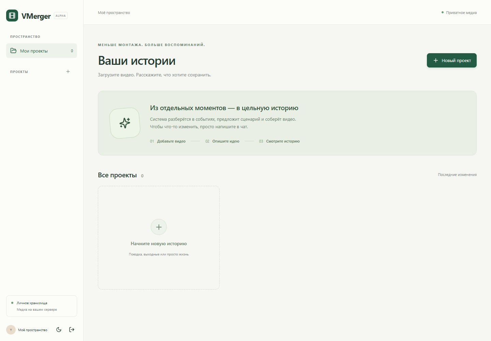
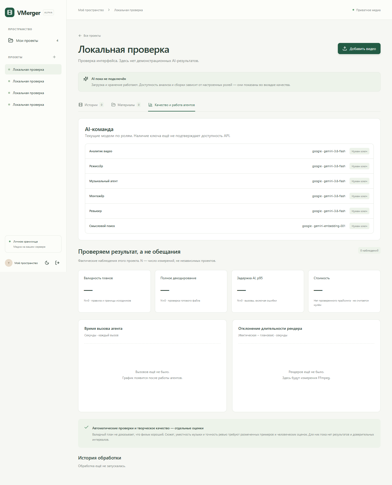
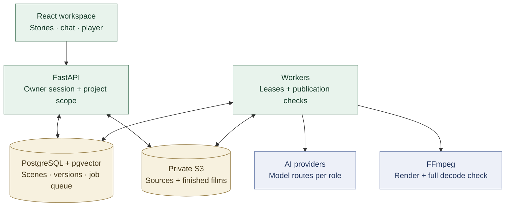
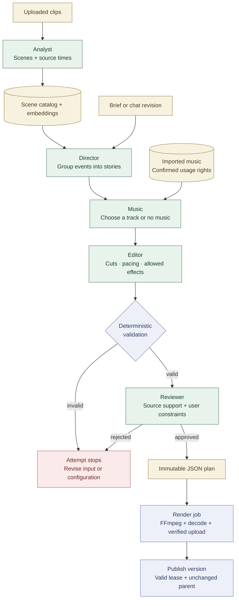

# VMerger

**Your footage, shaped into stories through a conversation.**

Turn a collection of video clips into a short film through chat. VMerger analyzes footage, builds a structured edit plan and renders it with FFmpeg. Originals and finished videos live in your own S3 storage.

[](https://github.com/Chaapa/VMerger/actions/workflows/ci.yml)
[](LICENSE)

[Quick start](#run-locally) · [Workflow](#workflow) · [Architecture](docs/architecture.md) · [Documentation](#documentation)

**Status: single-owner alpha.** Storage, rendering and orchestration have integration tests; live-model editing quality has not been evaluated.


*Application screenshot from the browser smoke test. The project is empty and AI providers are disconnected.*

<details>
<summary>More of the workspace</summary>

### Projects



### Measurements



These browser smoke-test captures show the interface before real project measurements exist.

</details>

## System overview



Media stays in your S3 storage. Hosted AI routes receive a proxy, frames or text for their role; [self-hosted inference](docs/self-hosted-llm.md) keeps that processing on your own endpoints.

## Run locally

Requires Docker with Compose and Python 3 to generate configuration.

```sh
git clone https://github.com/Chaapa/VMerger.git
cd VMerger
python scripts/configure.py
docker compose up --build -d
```

Open **http://127.0.0.1:8000** and sign in with `APP_TOKEN` from the generated `.env`. Set `MEDIA_ROOT` in `.env` before starting to choose where SeaweedFS stores media. PostgreSQL uses a separate Docker volume.

For analysis and editing, choose models in [`config/ai.toml`](config/ai.toml), add the referenced credentials to `.env`, then recreate the application services:

```sh
docker compose up -d --force-recreate api worker
```

Uploads and playback work without AI credentials. The selected providers receive the inputs needed for their roles: a video proxy or sampled frames for analysis, scene text and requests for planning. [Provider setup](docs/providers.md) explains cloud and self-hosted routes.

Using Windows without Docker? See [native setup](docs/local-setup.md). For a remote server, see [deployment](docs/deployment.md).

## Workflow

1. Create a project and upload your clips.
2. Analyze sources to build a searchable scene catalog.
3. Describe a film in chat. Director, music, editor and reviewer roles produce a structured plan.
4. The application validates source IDs, time ranges, duration, music rights and supported effects.
5. FFmpeg renders the plan, decodes the output and verifies the stored bytes before publication.
6. Request a change in chat. Each edit creates a new version; earlier versions remain available.

Music comes from tracks you import with confirmed usage rights. Supported effects are `none`, `warm`, `monochrome` and `fade`.

<details>
<summary>Inside the agent workflow</summary>



Analysis builds the catalog first. Planning then makes one pass per story through music selection, editing, validation and review. A rejected plan stops the attempt; agents do not automatically negotiate a repair.

</details>

## Engineering decisions

| Decision | Why it matters |
|---|---|
| PostgreSQL job queue with leases | Workers can claim jobs concurrently; an expired worker cannot publish a result. |
| Immutable plans and parent-version checks | A late render cannot replace a newer edit. |
| Private S3 with SHA-256 read-back verification | Stored media is verified before it becomes available through authenticated playback. |
| Per-role model routes and versioned embedding profiles | Models can change independently; search never mixes incompatible vector spaces. |
| Structured plans and fixed FFmpeg presets | Model output is validated data, with no model-generated shell commands. |

**Stack:** Python 3.12 · FastAPI · PostgreSQL + pgvector · SeaweedFS · FFmpeg · React + TypeScript · Docker Compose.

See [architecture and code map](docs/architecture.md) for the implementation and its tradeoffs.

## Development and verification

```sh
python -m venv .venv
# Activate the environment for your shell.
python -m pip install -r requirements.lock
python scripts/configure.py
python -m pytest
pnpm --dir web install --frozen-lockfile
pnpm --dir web run build
pnpm --dir web run test
```

The default Python suite skips service integration tests. [Testing](docs/testing.md) covers PostgreSQL/S3/FFmpeg integration, browser checks and CI. [Operations](docs/operations.md) explains the measurements in the UI and Prometheus.

## Current limits

One owner; no collaboration or OIDC. Defaults allow 30 sources per project, 500 MB and 10 minutes per source, up to 300 scenes in planning context, six stories per request and five minutes per story. Output is 720p at 30 fps. Uploads pass through the API and restart from the beginning after an interruption.

The next useful milestones are live-provider evaluation, resumable uploads and complete project deletion/storage reconciliation. Automatic GPU provisioning, word-aligned transcription and production availability guarantees are outside the current implementation.

## Documentation

- [Architecture and code map](docs/architecture.md)
- [Provider configuration](docs/providers.md) and [self-hosted inference](docs/self-hosted-llm.md)
- [Server deployment](docs/deployment.md) and [native Windows setup](docs/local-setup.md)
- [Testing](docs/testing.md) and [operations](docs/operations.md)

## License

[MIT](LICENSE). Dependencies, model weights and imported media retain their own licenses.
