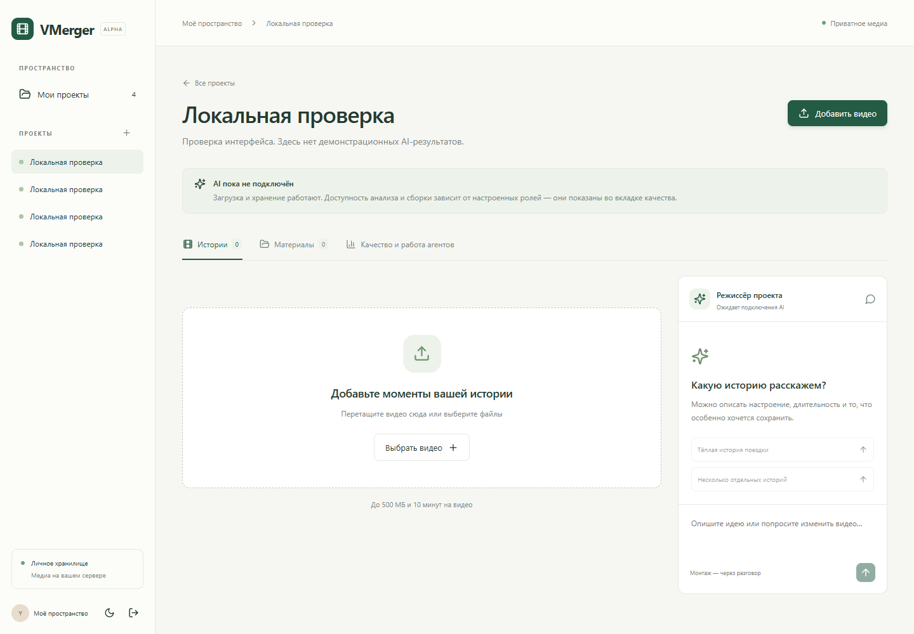
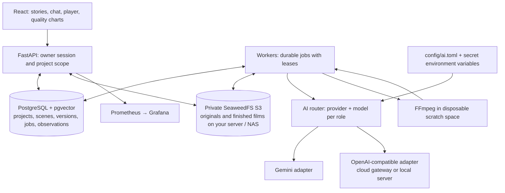
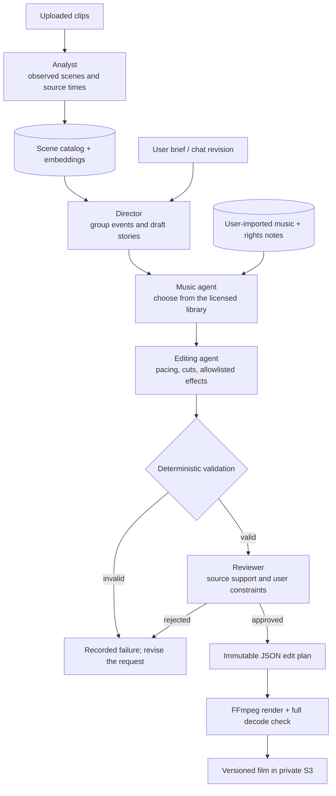
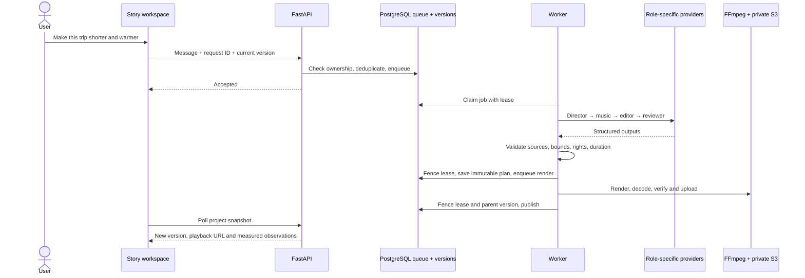
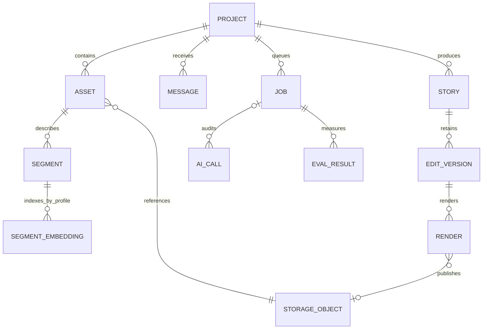
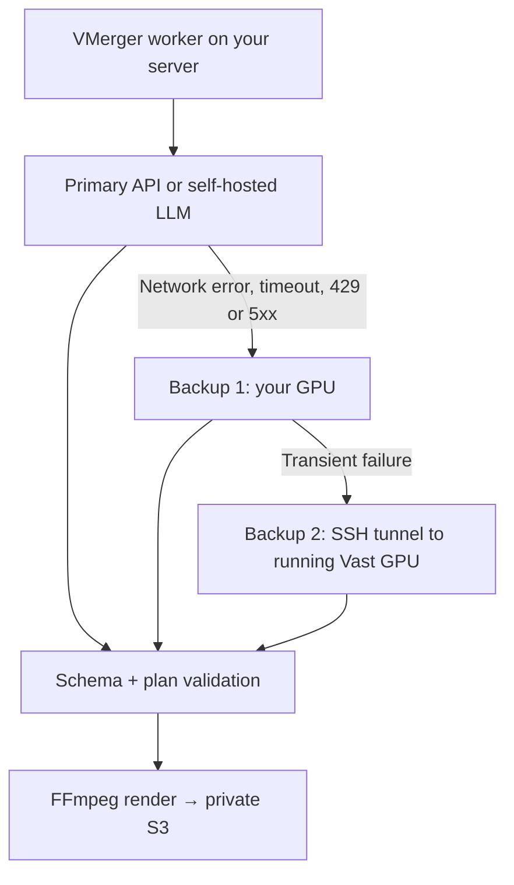

# VMerger

**Your footage, shaped into stories through a conversation.**

A self-hosted video-editing prototype: upload clips, describe the film you want, then request changes in chat. A director, music selector, editing agent and reviewer produce a validated edit plan. FFmpeg renders it; the user never operates a timeline.

[](https://github.com/Chaapa/VMerger/actions/workflows/ci.yml)
[](LICENSE)



**Status: runnable alpha, single owner.** The real PostgreSQL/S3/FFmpeg path has been tested locally. AI providers and models are selectable per role; no live provider calls were made during local validation. Provider contract fixtures test orchestration and API formats; they do not demonstrate AI editing quality. See [measured validation](docs/local-validation.md) and [implemented scope](docs/implementation.md).

## What works

- Authenticated workspace, project cards, video uploads, licensed music library, light/dark themes and mobile layout.
- Private S3 storage, SHA-256 verification of stored bytes, content deduplication and authenticated byte-range playback.
- PostgreSQL + pgvector scene catalog, full-text and scoped semantic search, immutable plans and version history.
- Four creative roles with structured outputs and deterministic checks of source IDs, clip ranges, effects and music provenance.
- A shared AI router with Gemini and OpenAI-compatible adapters, independent models per role and isolated embedding profiles.
- Self-hosted inference endpoints and opt-in creative-agent failover to an already running backup, including a rented GPU behind SSH.
- Durable PostgreSQL jobs, concurrent claims, lease heartbeats, cancellation and fenced result publication.
- FFmpeg assembly with audio normalization of format, silence for silent clips, optional music mixing, allowlisted effects and full output decoding.
- Real per-project observations and charts, provider call history, Prometheus metrics, Grafana dashboard and alert rules.

The UI intentionally shows **no data** before measurements exist. Cost is unknown until pricing is configured; successful decoding is not a judgment of artistic quality.

## Architecture



API and workers are separate processes from one codebase. Media lives in S3; workers use disposable scratch directories. Claims use `FOR UPDATE SKIP LOCKED`; publication verifies an unexpired lease token and the expected parent version. A retry cannot overwrite a newer film.

Stack: Python 3.12, FastAPI, Pydantic, psycopg, Alembic, PostgreSQL 18, pgvector 0.8.7, SeaweedFS, FFmpeg, google-genai/httpx, React/TypeScript/Vite, Recharts, pytest/Hypothesis and Playwright. SQL is explicit rather than duplicated in ORM models.

## The agent team

Agents are bounded roles in one workflow. Each can use a different model or provider; application code controls storage, job state and rendering.



| Role | Responsibility | Output / boundary |
|---|---|---|
| Analyst | Observe what happens in the supplied footage | Scene descriptions and source time ranges; frame-only mode cannot transcribe speech |
| Director | Turn related moments into one or more stories | Structured story plans or one revision of the selected story |
| Music agent | Match the requested mood to available music | A licensed library asset ID, or no music |
| Editing agent | Refine pacing and select effects | Valid clip ranges; `none`, `warm`, `monochrome`, `fade` only |
| Reviewer | Check source support and the requested changes | Approval and issues; model judgment is measured separately from hard validation |
| Embedding route | Index scene text and encode search queries | Normalized 768-dimensional vectors in a versioned profile |

Agents cannot download arbitrary effects, invent music licenses or execute shell commands. Music marketplace search, richer effect catalogs and aligned speech recognition are future work.

## From chat to a new version



## What is stored where



This is a conceptual view of the implemented tables. PostgreSQL stores ownership, relationships, plans, queue leases and measurements; pgvector stores scene embeddings. `storage_objects` contains object keys, hashes and lifecycle metadata, while the media bytes live in private S3. Source videos and completed films are not Git assets or permanent application-directory files. See the [base schema](docs/schema.sql) and [incremental migrations](migrations/versions).

## Switch providers and models

Edit [`config/ai.toml`](config/ai.toml). `[default]` selects the creative-role default; `[routes.analyst]`, `[routes.embedding]` and optional `[routes.director|music|editor|reviewer]` select independent models. For example:

```toml
# Change these existing sections; do not append duplicate TOML tables.
[providers.gateway]
adapter = "openai_compatible"
base_url = "https://your-provider.example/v1"
api_key_env = "AI_API_KEY"
response_format = "json_schema"
token_parameter = "max_completion_tokens"

[default]
provider = "gateway"
model = "your-planning-model"

[routes.reviewer]
provider = "gateway"
model = "your-review-model"
```

Put `AI_API_KEY` in `.env`. Keep or change the analyst and embedding routes separately. You can define multiple compatible endpoints with separate key variables, including a local inference server. Each job attempt snapshots the configuration; file changes affect subsequent attempts without rebuilding the application. Restart API/worker after changing environment secrets and refresh the browser to see the current routes under **Quality and agents → AI team**.

The compatible adapter uses Chat Completions and Embeddings HTTP contracts. Its analyst mode sends a bounded set of timestamped JPEG frames to a vision-capable model: it has no audio and may miss brief events. Gemini uses the reduced video directly. Endpoint support for JSON schemas, token parameters and 768-dimensional embeddings must match the configuration. See [provider configuration, capabilities and examples](docs/providers.md).

Changing an embedding model, compatible endpoint or text prefixes selects a different profile. Click **Sources → Rebuild search** to populate it from existing scene text. Old vectors and videos remain intact; semantic search refuses an incomplete profile instead of comparing incompatible vectors.

### Your own LLM and GPU fallback

Run a compatible model server such as vLLM on your own GPU or a rented machine on Vast.ai. VMerger connects from your server over a private endpoint or SSH tunnel. The following chain is configurable independently for the director, music, editor and reviewer roles:



Fallback is disabled by default and limited to two explicitly configured backups. Every attempt is audited against its actual provider/model. Invalid output, refusals and credential errors stop the call. Analyst and embedding routes remain explicit to preserve media capabilities and vector-space compatibility. See the [hybrid configuration example](config/ai.hybrid.example.toml) and [self-hosting / Vast.ai deployment guide](docs/self-hosted-llm.md).

**Automatic GPU rental is a documented next step, not shipped behavior.** The guide separates a running backup endpoint from a future controller that rents capacity, waits for model readiness, resumes queued work and releases idle instances under a spending limit. No GPU rental or live-model validation has been performed for this release.

## Run with Docker

Requires Docker Engine with Compose, Python 3 for configuration generation, and enough local disk for footage and temporary renders.

```sh
git clone https://github.com/Chaapa/VMerger.git
cd VMerger
python scripts/configure.py
docker compose up --build -d
```

Open **http://127.0.0.1:8000**. Sign in with `APP_TOKEN` from the generated `.env`. Secrets and media are ignored by Git. Set `MEDIA_ROOT` in `.env` to a directory on your server/NAS before starting if you want a different storage location. PostgreSQL uses its own local volume.

Without configured AI credentials, uploads, storage and the interface work. Select routes in `config/ai.toml`, add their referenced keys to `.env`, restart the API/worker, then click **Sources → Analyze** for existing videos. The bundled configuration retains Gemini as one starting option. Only the selected providers receive model inputs; originals remain in private S3. Compose mounts the configuration directory read-only into API and worker.

```sh
docker compose up -d --force-recreate api worker
docker compose --profile monitoring up -d prometheus grafana
```

Grafana: http://127.0.0.1:3000 (`admin`, password = `APP_TOKEN`). Prometheus: http://127.0.0.1:9090. These ports bind only to loopback. The dashboard is provisioned automatically; outbound alert delivery is not configured.

For Windows without Docker, see [native local setup](docs/local-setup.md). For TLS, backups and deployment steps, see [server deployment](docs/deployment.md).

## Validation

```sh
python -m venv .venv
# Activate the venv for your shell.
pip install -r requirements.lock
pytest                                      # pure contract/property tests
pytest --integration --cov=vmerger --cov-report=json:.local/coverage.json
python scripts/check_coverage.py
pnpm --dir web install --frozen-lockfile
pnpm --dir web run build
pnpm --dir web run test
pnpm --dir web exec playwright install chromium
pnpm --dir web exec playwright test          # running API, live providers disabled
```

Integration tests create a fresh schema and an explicitly scoped Alembic version table. They use real PostgreSQL, S3 and FFmpeg, then remove their own data. Test videos and provider fixtures are explicitly marked; personal footage and invented benchmark results are never committed. The browser smoke test creates an empty project named “Local validation”.

CI builds the Compose stack on Linux and runs the backend, frontend and browser checks. Current backend floors are 80% lines / 75% branches; contract and lease modules have stricter floors. See the validation document for measured coverage and remaining gaps.

## Limits and next steps

This release is intentionally bounded: one owner, 30 sources/project, 500 MB and 10 minutes/source, up to 300 scene records in planning context, 6 stories/request, 5 minutes/story, 720p output. Uploads pass through the API and do not resume. Music selection uses your imported library; external music marketplaces and effect downloads are not implemented. Speech spans come from the video model, not word-aligned ASR.

Multi-user OIDC, resumable direct-to-S3 uploads, full deletion/reconciliation, sandboxed media processing, aligned speech and beat analysis, human evaluation datasets, dollar budgets, distributed tracing and measured backup restoration remain future work. Worker processes can scale now; the complete production architecture is a design target, not a claim that all of it is shipped.

## Project notes

- [Architecture and schema](docs/architecture.md)
- [Agent roles and effects](docs/agents-and-effects.md)
- [Provider routing and model switching](docs/providers.md)
- [Self-hosted LLMs, failover and Vast.ai](docs/self-hosted-llm.md)
- [Evaluation formulas and acceptance criteria](docs/agent-evaluation.md)
- [Quality and operations design](docs/quality-and-operations.md)
- [Implementation decisions and deviations](docs/implementation.md)
- [Portfolio narrative draft](docs/portfolio.md)

The commit sequence groups the implementation into milestones.

## License

[MIT](LICENSE). Anyone may use, modify, redistribute and sell this software, including in commercial products, while retaining the copyright and license notice. Model weights, dependencies and imported media keep their own licenses.
