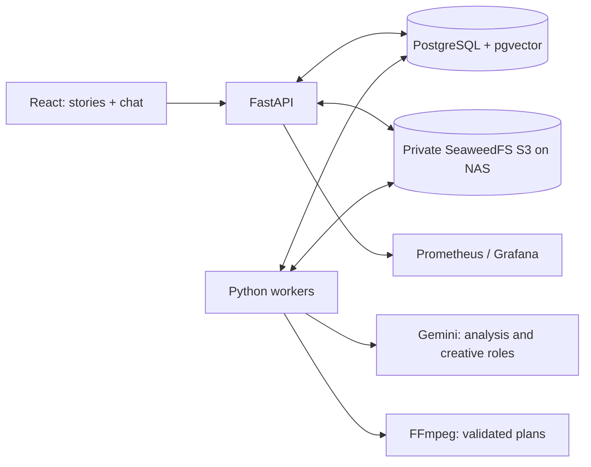

# VMerger

**Your footage, shaped into stories through a conversation.**

A self-hosted video-editing prototype: upload clips, describe the film you want, then request changes in chat. A director, music selector, editing agent and reviewer produce a validated edit plan. FFmpeg renders it; the user never operates a timeline.

[](https://github.com/Chaapa/VMerger/actions/workflows/ci.yml)


**Status: runnable alpha, single owner.** The real PostgreSQL/S3/FFmpeg path has been tested locally. Gemini is optional configuration and was **not called during the initial validation**. Provider contract fixtures test orchestration; they do not demonstrate AI editing quality. See [measured validation](docs/local-validation.md) and [implemented scope](docs/implementation.md).

## What works

- Authenticated workspace, project cards, video uploads, licensed music library, light/dark themes and mobile layout.
- Private S3 storage, SHA-256 verification of stored bytes, content deduplication and authenticated byte-range playback.
- PostgreSQL + pgvector scene catalog, full-text and scoped semantic search, immutable plans and version history.
- Four creative roles with structured outputs and deterministic checks of source IDs, clip ranges, effects and music provenance.
- Durable PostgreSQL jobs, concurrent claims, lease heartbeats, cancellation and fenced result publication.
- FFmpeg assembly with audio normalization of format, silence for silent clips, optional music mixing, allowlisted effects and full output decoding.
- Real per-project observations and charts, provider call history, Prometheus metrics, Grafana dashboard and alert rules.

The UI intentionally shows **no data** before measurements exist. Cost is unknown until pricing is configured; successful decoding is not a judgment of artistic quality.

## Architecture



API and workers are separate processes from one codebase. Media lives in S3; workers use disposable scratch directories. Claims use `FOR UPDATE SKIP LOCKED`; publication verifies an unexpired lease token and the expected parent version. A retry cannot overwrite a newer film.

Stack: Python 3.12, FastAPI, Pydantic, psycopg, Alembic, PostgreSQL 18, pgvector 0.8.7, SeaweedFS, FFmpeg, google-genai, React/TypeScript/Vite, Recharts, pytest/Hypothesis and Playwright. SQL is explicit rather than duplicated in ORM models.

## Run with Docker

Requires Docker Engine with Compose, Python 3 for configuration generation, and enough local disk for footage and temporary renders.

```sh
git clone https://github.com/Chaapa/VMerger.git
cd VMerger
python scripts/configure.py
docker compose up --build -d
```

Open **http://127.0.0.1:8000**. Sign in with `APP_TOKEN` from the generated `.env`. Secrets and media are ignored by Git. Set `MEDIA_ROOT` in `.env` to a directory on your server/NAS before starting if you want a different storage location. PostgreSQL uses its own local volume.

Without a Gemini key, uploads, storage and the interface work; the app explains why AI creation is unavailable. To enable it, put `GEMINI_API_KEY` in `.env`, restart the API and worker, then click **Материалы → Проанализировать** for existing videos. The default model is configurable. Reduced video proxies are sent to Google; originals remain in private S3.

```sh
docker compose up -d --force-recreate api worker
docker compose --profile monitoring up -d prometheus grafana
```

Grafana: http://127.0.0.1:3000 (`admin`, password = `APP_TOKEN`). Prometheus: http://127.0.0.1:9090. These ports bind only to loopback. The dashboard is provisioned automatically; outbound alert delivery is not configured.

For Windows without Docker, see [native local setup](docs/local-setup.md). For TLS, backups and deployment steps, see [server deployment](docs/deployment.md).

## Validation

```sh
python -m venv .venv
# Activate the venv for your shell.
pip install -r requirements.lock
pytest                                      # pure contract/property tests
pytest --integration --cov=vmerger --cov-report=json:.local/coverage.json
python scripts/check_coverage.py
pnpm --dir web install --frozen-lockfile
pnpm --dir web run build
pnpm --dir web run test
pnpm --dir web exec playwright install chromium
pnpm --dir web exec playwright test          # running API, Gemini disabled
```

Integration tests create a fresh schema and an explicitly scoped Alembic version table. They use real PostgreSQL, S3 and FFmpeg, then remove their own data. Test videos and provider fixtures are explicitly marked; personal footage and invented benchmark results are never committed. The browser smoke test creates an empty project named “Локальная проверка”.

CI builds the Compose stack on Linux and runs the backend, frontend and browser checks. Current backend floors are 80% lines / 75% branches; contract and lease modules have stricter floors. See the validation document for measured coverage and remaining gaps.

## Limits and next steps

This release is intentionally bounded: one owner, 30 sources/project, 500 MB and 10 minutes/source, up to 300 scene records in planning context, 6 stories/request, 5 minutes/story, 720p output. Uploads pass through the API and do not resume. Music selection uses your imported library; external music marketplaces and effect downloads are not implemented. Speech spans come from the video model, not word-aligned ASR.

Multi-user OIDC, resumable direct-to-S3 uploads, full deletion/reconciliation, sandboxed media processing, aligned speech and beat analysis, human evaluation datasets, dollar budgets, distributed tracing and measured backup restoration remain future work. Worker processes can scale now; the complete production architecture is a design target, not a claim that all of it is shipped.

## Project notes

- [Architecture and schema](docs/architecture.md)
- [Agent roles and effects](docs/agents-and-effects.md)
- [Evaluation formulas and acceptance criteria](docs/agent-evaluation.md)
- [Quality and operations design](docs/quality-and-operations.md)
- [Implementation decisions and deviations](docs/implementation.md)
- [Portfolio narrative draft](docs/portfolio.md)

The commit sequence groups the implementation into milestones.
