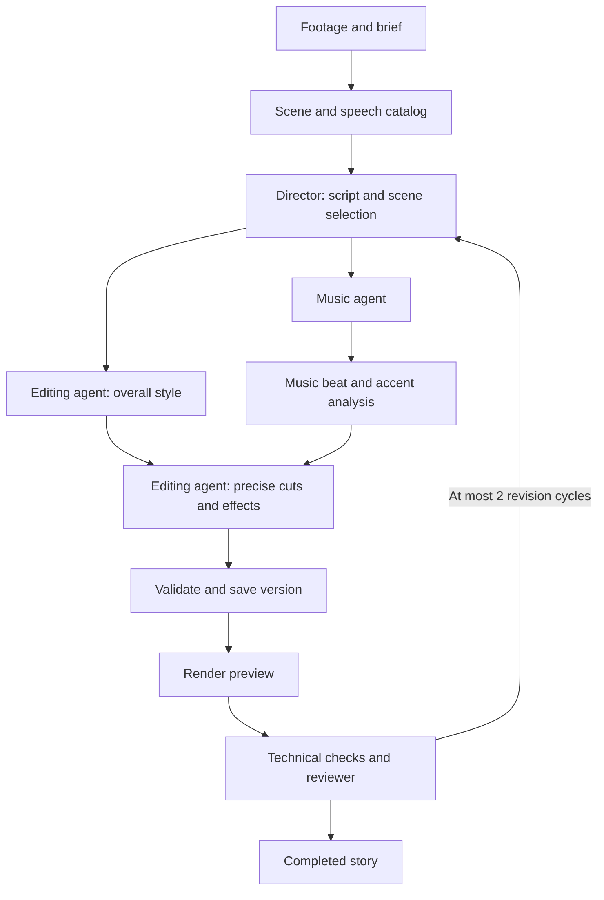

# VMerger: agents and editing effects

Date: October 23, 2026. Status: target architecture. The alpha implements a bounded, single-pass role workflow; the broader catalog, tools and preview-review loop below remain future work. See [architecture](architecture.md) and [implemented scope](implementation.md).

## 1. Roles and orchestration

Users upload material and give instructions in one project/story chat. A director defines the story, music and editing agents propose sound and treatment, and a reviewer assesses the preview. Users need not approve each intermediate creative decision.

| Role | Responsibility | Output |
|---|---|---|
| Director / scriptwriter | Structure, actual scenes, required moments and user requirements | Script with source references and sequence plan |
| Music agent | Search, analyze and select available music; propose placement | Track, provenance, usage terms and musical accents |
| Editing agent | Pace, cut boundaries, transitions, speed, crop, titles, color, overlays and sound accents | Change proposal against a specific plan version |
| Reviewer | Request compliance, coherence, repetition and visible preview problems | Prioritized timestamped findings |

Roles are model/context/tool configurations in one codebase. In the alpha, each role chooses its provider/model through `config/ai.toml`; Gemini and compatible adapters return structured JSON. Orchestration executes operations, checks access and commits results. Agents do not need direct SQL or shell access. Function calling and extensible tools are target features beyond the current role pass. See [provider configuration](providers.md).

The director owns creative choices; orchestration owns job state, shared budget, cancellation, retries and publication. Specialists work against a `base_version_id` snapshot. Merge and validate proposals before a single publication operation checks the current version and lease token. Recompute stale proposals against the new version.



Independent music/style searches may run in parallel. Precise beat-aware cuts follow music selection. Speech and “keep this whole” requirements take priority over beat alignment.

## 2. Editing agent

Inputs are script, plan snapshot, selected music, speech map, source properties, user instructions and renderer capabilities. Inspect specific excerpts and short effect trials when needed; decisions must use actual footage.

| Task | Example | Initial scope |
|---|---|---|
| Pacing | Shorten similar shots or support an accent | Cuts/durations with speech checks |
| Transitions | Cut, dissolve, fade | Small set of verified presets |
| Movement | Gentle zoom and crop | Crop bounds and important-region preservation |
| Speed | Accelerate a long road sequence | Constant speed per section; ramps later |
| Color | Match neighboring shots or warm the image | Corrections and verified LUTs with color-space checks |
| Text | Story title, place, short caption | Typography templates, safe areas and font checks |
| Overlays / sound | Subtle grain or sound accent | Supported media and bounded intensity |

A target starter catalog of roughly 15–25 presets is a development guideline, not shipped inventory. Natural style permits plain cuts and no decorative effects. “More dynamic” may change pace without adding a transition to every cut. Stabilization, complex tracking and generative effects require separate quality/cost validation.

## 3. Finding effects and external resources

Search the internal catalog by purpose, style, category and engine capabilities first. Tags and text search suffice for a small catalog. If needed later, add a separate embedding profile in PostgreSQL without mixing effect and video indexes.

A preset includes effect ID, immutable version, purpose, tags, parameter schema/bounds, compatible formats/color spaces, rendering cost, dependencies, supported engine versions and preview.

Built-in presets ship as versioned declarative backend manifests. User-defined sets can receive a PostgreSQL table when a catalog editor exists. Media/previews persist in NAS-backed S3.

External search uses adapters for selected catalogs. Results include source ID, resource type, license information, compatibility and import support. Approved resources can import within budget. Finding an arbitrary editing template online does not make it executable: exclude templates requiring another editor until an adapter exists.

The importer fetches a trusted-catalog resource by ID, verifies format, size, content and SHA-256, stores it in private S3 and records source, usage terms and license confirmation. Music, sounds, images and video use `assets`. LUTs and other dependencies use `storage_objects` and typed plan references. Validators check format, access and availability. Agents do not install downloaded plugins or execute discovered code. Catalog descriptions are data, not instructions.

## 4. Tools

The backend binds project and permissions to the job context. Models supply IDs of entities available in that context. Example target interfaces:

```text
search_effects(query, category, capabilities) -> presets
get_effect(effect_id, version) -> manifest
inspect_clip(asset_id, source_interval_us) -> observations
search_resources(query, resource_type, usage_requirements) -> candidates
import_resource(provider, resource_id) -> verified_resource
preview_effect(base_version_id, proposal, interval_us) -> preview_job_id
get_preview_result(preview_job_id) -> status_and_media_reference
submit_edit_proposal(base_version_id, operations) -> validated_proposal
```

Effect trials have an input hash, budget, retention and idempotency key. Render workers handle long trials; waiting is checkpointed and releases the AI slot. Retrying a tool with identical input returns its previous job. Imports are also idempotent, and result publication requires the current lease.

The model selects an allowed preset and parameters. The plan compiler builds the FFmpeg filtergraph; model text is never inserted into shell commands or arbitrary filter expressions. Normalize stream compatibility before xfade and test presets on a pinned FFmpeg build. More complex graphics may later use another renderer behind the same contract.

## 5. Plans and storage

Canonical results live in a new version of the `edit_versions.plan` contract. Beyond script, clips and music, plans include stable effect-instance IDs, preset version/snapshot/hash, validated parameters and time bindings. Resources use internal IDs and hashes, not temporary URLs. The render profile pins engine build and dependencies.

Time bindings distinguish source time, time inside a clip occurrence after speed changes, and final-film time. Transitions identify neighboring clip IDs and overlap duration. The compiler computes positions/duration, validates bounds and updates chat's time map. Crop/title coordinates are frame-relative so proxies and exports preserve composition.

Beat analysis and track selection are versioned. Music-dependent cuts/effects declare their dependency so replacing music recomputes only affected decisions. “Keep the edit” fixes clip boundaries and adapts music/accents around them.

| Data | Storage |
|---|---|
| Active stage, candidate plans, budget | jobs.checkpoint |
| Committed script and edit | edit_versions.plan and constraints |
| Media and dependencies | assets / storage_objects, bytes in S3 |
| Full-version previews/exports | renders |
| Temporary effect trials | Verified storage_objects, checkpoint references and bounded retention |
| Model calls and usage | ai_calls |
| Step/tool audit | Planned agent_steps: job ID, step number, role, tool-call ID, input fingerprint, result references, status and time |

An agent step records an operation and observed result, not hidden model reasoning. Events belong to a project/job; large detail can live in S3. agent_steps needs its own migration; the initial schema is the 16-table baseline.

Cleanup follows every saved-version dependency: selected tracks, overlays, LUTs, fonts and preset definitions remain while referenced. Imported resources are immutable. Rendering an old version performs no new search or creative selection. Snapshots reproduce decisions; different hardware encoders are not promised bit-identical bytes.

## 6. Verification, limits and user edits

Each role has measurable criteria and version-comparison charts in [agent evaluation](agent-evaluation.md). Test the reviewer against known defects and clean controls; its own ratings are not ground truth for other roles.

Before publication, code checks resource ownership, ranges, preset compatibility, dependencies, duration, supported parameters and user constraints. After rendering, check playback, tracks, duration and technical errors. The target reviewer inspects the actual preview and cut neighborhoods. User-project evaluations also assess final quality. The complete checks are in [quality and operations](quality-and-operations.md).

Jobs share limits for money, time, calls and effect trials; each child role receives part of the same budget. Reserve cost before a paid operation and reconcile afterward; unknown spend does not become zero. Allow at most two creative revision cycles. On exhaustion, retain the best technically valid version satisfying all hard rules and report unmet soft wishes. If none exists, fail with an accessible checkpoint and preserve the previous ready version. Cancellation or lease loss prevents all child publication.

Every stage/tool carries request/job/attempt/trace context. Audit actual operations and results. Measure duration, steps, schema/tool failures, corrections, cost and exhausted budgets. Keep secrets, signed URLs and user-media contents out of telemetry. Effects need parameter and actual-render tests. Agents need control projects, invalid answers, media prompt-injection cases, lease loss, cancellation and retried tool calls. Compare changed models/prompts/presets with an accepted baseline on a separate holdout.

Run only needed roles. “Remove the zooms” changes the edit plan and render. “Change the music, keep the edit” fixes clips and reruns music work. “Make a separate hiking film” returns to the director. These edits do not require reanalyzing all sources.

The Stories interface keeps one chat, player and version history. Progress reflects real stages: “Planning the story,” “Selecting music,” “Designing the edit,” “Checking the result.” Afterward, provide a short change description, such as “Sped up the road sequence, added the trip title, preserved conversations and softened the ending.”

## References

- [Gemini function calling](https://ai.google.dev/gemini-api/docs/function-calling)
- [FFmpeg filters and media processing](https://www.ffmpeg.org/ffmpeg-filters.html)
- [FFmpeg xfade input requirements](https://ffmpeg.org/pipermail/ffmpeg-cvslog/2021-April/127243.html)
- [Anthropic: agents and workflows](https://www.anthropic.com/research/building-effective-agents)
