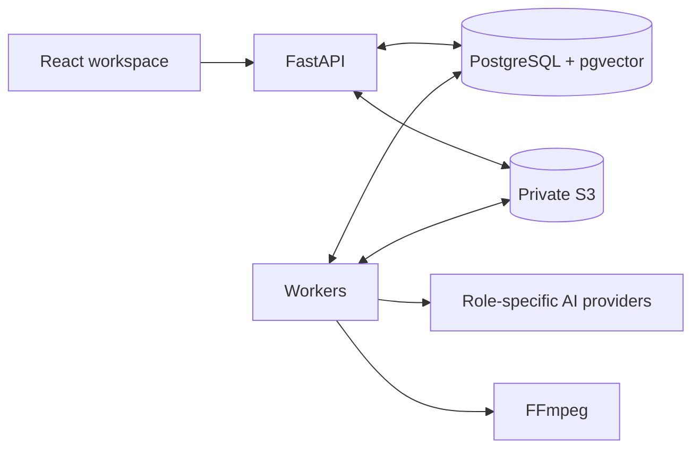

# Architecture

VMerger is a single-owner application with a FastAPI service and separate worker processes. PostgreSQL stores project state, jobs and edit history. S3 stores media; workers use temporary local files during processing.

## Code map

| Component | Responsibility |
|---|---|
| [`api.py`](../vmerger/api.py) | Sessions, project ownership, uploads, chat, search and byte-range playback |
| [`pipeline.py`](../vmerger/pipeline.py) | Analysis, planning, rendering and embedding reindex jobs |
| [`contracts.py`](../vmerger/contracts.py) | Structured outputs, source bounds, music authorization and embedding normalization |
| [`jobs.py`](../vmerger/jobs.py) | Job claims, leases, cancellation and publication checks |
| [`providers.py`](../vmerger/providers.py), [`ai_config.py`](../vmerger/ai_config.py) | Provider adapters, model routes and call audit |
| [`storage.py`](../vmerger/storage.py), [`media.py`](../vmerger/media.py) | S3 verification, media probing and FFmpeg rendering |
| [`migrations/`](../migrations) | Database schema and incremental migrations |
| [`web/src/`](../web/src) | Stories, chat, sources, versions and measurement views |

## From footage to a film

Uploads pass through the API, which checks size and media metadata. Bytes are stored in S3, read back and hashed with SHA-256 before the object becomes available. Duplicate sources are reused within a project. Playback passes through an authenticated API route supporting byte ranges.

Analysis downloads the source into temporary storage and creates a reduced proxy. The selected analyst returns scenes with descriptions and source times; the application checks the times against the source duration. Scene text is embedded and stored in PostgreSQL.

The planning pipeline uses these roles:

| Role | Input and output |
|---|---|
| Analyst | Video proxy or sampled frames → scenes and source time ranges |
| Director | Brief, chat request, scenes and optional previous plan → proposed stories |
| Music | Story and imported music library → one authorized asset ID or no music |
| Editor | Story plan and request → clip order, pacing and supported effects |
| Reviewer | Scenes, request and validated plan → approval or issues |

The director returns up to six stories. Each story passes through music selection, editing, deterministic validation and review. A rejected plan stops the attempt. There is no automatic repair conversation between agents.

Plans contain source UUIDs, clip ranges, effect names and an optional music asset. Validation enforces project membership, positive ranges of at least 250 ms, source bounds, output duration and confirmed music rights. The renderer maps the four allowed effect names to fixed FFmpeg filters. Models cannot supply shell commands or arbitrary filter expressions.

Approved plans are immutable `edit_versions`. A render job downloads the required media, assembles video and audio, fully decodes the result and verifies its S3 upload. Only then can the version become current. FFmpeg scratch files are removed after processing.

## Jobs and concurrent edits

[`jobs.claim`](../vmerger/jobs.py) selects work with `FOR UPDATE SKIP LOCKED` in a short transaction. Each claim creates a fresh lease token. A heartbeat extends that lease while processing; expired work can be retried up to its attempt limit.

Before publishing, a worker locks the project and checks that its job still has a valid, uncancelled lease. Planning also checks the message's expected version. Rendering checks that the story's current version still matches the plan's parent. A late worker therefore cannot make an obsolete edit current.

Execution is at least once. Provider requests and temporary uploads may repeat after a failure; publication checks protect durable results. PostgreSQL and S3 do not share a transaction. Failed, unreferenced objects can be removed by [`cleanup.py`](../vmerger/cleanup.py); recovery of objects left in `writing` after a crash still needs operator attention.

API and workers share the same codebase. Worker pools can be split into `ai` and `render` queues. The browser polls project snapshots; there is no message broker or push event stream.

## Data and search

The initial schema is in [`migrations/sql/001_initial.sql`](../migrations/sql/001_initial.sql). Migration `001` loads it and adds evaluation observations; migration `002` allows reindex jobs.

- Projects own assets, scenes, messages, stories and jobs.
- Assets and renders reference verified storage-object metadata; media bytes remain in S3.
- Stories retain immutable plans and a pointer to the current rendered version.
- Scene embeddings use normalized 768-dimensional vectors and a profile key.
- `ai_calls` stores provider attempts; `eval_results` stores rule/provider observations.

Search is scoped to the authenticated project. Full-text search works without a model. Semantic search uses an exact query over the selected embedding profile; the schema's partial HNSW index is not a measured performance claim. A missing vector in the selected profile produces HTTP 409 until reindexing completes. Old profiles are retained.

The baseline also reserves tables for upload sessions, derivatives and provider files. Their complete lifecycles are not implemented. Use the API and migration code as the source of truth for supported operations.

## Boundaries and tradeoffs

Sessions use HttpOnly cookies; mutations check Origin and an application request header. Project operations check ownership. The browser receives neither S3 secrets nor inference credentials. Hosted analysis still sends a proxy or frames to the configured provider; self-hosting storage alone does not make inference local.

The alpha favors a small deployment: one database account, a single SeaweedFS node, API-mediated uploads and fixed rendering presets. It does not yet provide multi-user identity, resumable uploads, a complete deletion workflow, sandboxed media processing or high availability.

[Provider configuration](providers.md) covers model routing and failover. [Testing](testing.md) describes what is exercised; [operations](operations.md) defines the measurements.
