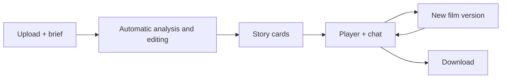
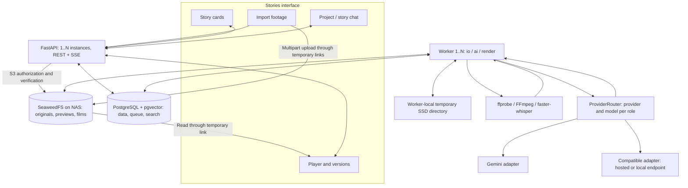
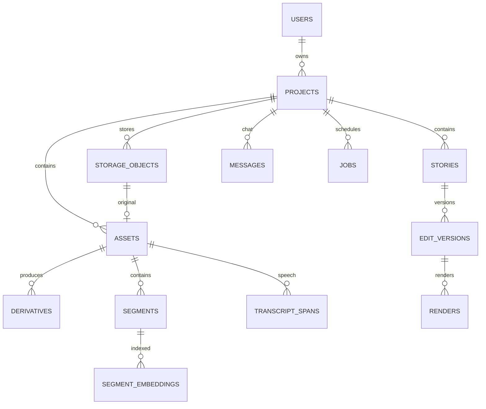

# VMerger: architecture designed to scale

Date: October 23, 2026; updated for provider routing and failover. Status: target architecture. The working alpha implements a limited subset; see [implemented scope](implementation.md) and [measured local validation](local-validation.md).

The primary database is PostgreSQL with pgvector. One modular codebase serves independent API and worker processes, which can run on different hosts. One API and one worker are enough initially.

Deployment is on the owner's server or NAS. Persistent media lives in private SeaweedFS object storage through its S3 API. The user's computer handles uploads and playback; processing continues on the server after an upload finishes.

Supporting documents cover [agents and editing effects](agents-and-effects.md), [validation, monitoring and testing](quality-and-operations.md), and [agent metrics and charts](agent-evaluation.md). [Early SQL validation](validation.md) records a separate experiment. Design requirements are not test results.

## 1. Product and interface

The selected **Stories** design uses calm green accents, large covers, and light and dark themes. Users upload footage, receive assembled stories, watch them, and request changes in chat. The system makes editing decisions.

The interface has three states:

1. **New project.** Upload files or a folder, with an optional brief describing the footage and desired result. Sources are sufficient: the system can propose format, number of films and duration.
2. **Project stories.** Cards show a cover, title, duration, summary and actual processing status. Project chat handles requests such as “Combine the beach and mountain footage” or “Make a separate hiking film.”
3. **Story viewer.** Story navigation, a central player and a story-specific chat. Versions, comparison and download sit below the player. On mobile, chat sits below the video.

There is no manual timeline, clip dragging or trimming UI. Suggestion buttons submit ordinary text requests. Viewing an earlier version does not make it current; restoration is a separate command.



## 2. Stack, access and deployment

| Component | Choice | Responsibility |
|---|---|---|
| Interface | React, TypeScript, Vite | Projects, stories, chat and playback |
| API | Python, FastAPI, Pydantic | Authentication, commands and state queries |
| Data | PostgreSQL 18, SQLAlchemy, Alembic | Owners, projects, versions and queue |
| Search | pgvector >= 0.8.0, PostgreSQL FTS | Vector and text search in the database |
| Media | SeaweedFS S3 API, boto3 | Private objects on the owner's NAS/server |
| Processing | Python worker, io/ai/render queues | Imports, analysis and editing |
| Video and speech | ffprobe, FFmpeg, faster-whisper | Metadata, derivatives, speech and rendering |
| AI | ProviderRouter: Gemini and compatible HTTP APIs | Separate providers/models for analysis, creative roles and embeddings |
| Updates | REST + SSE | Progress, replies and current state |
| Observability | OpenTelemetry, JSON logs, Prometheus, Grafana, Alertmanager | Traces, metrics, diagnostics and alerts |
| Verification | pytest, Hypothesis, Vitest, Playwright, k6 | Logic, integrations, UI, media and load |

These are target choices; the alpha uses explicit psycopg SQL, polling and a smaller toolset. Modules cover identity/projects, media, catalog/search, editing/agents, jobs and provider adapters. API and workers share domain models and service operations. Scale process counts without duplicating domain logic across microservices.

SeaweedFS can run on the NAS or application server. A separate CPU/GPU host handles processing if the NAS is underpowered. Verify container/binary compatibility before installation. PostgreSQL is network-accessible internally, with its data directory on the database host's disk, not S3 or an SMB/NFS folder.

Projects have `owner_id` from the first release. In the target identity design, `users` maps UUIDs to verified identity-provider issuer/subject pairs; email is not permanent identity. The API validates signature, issuer, audience and expiry, or trusts only a protected authentication gateway that prevents header forgery. Browser authentication uses secure cookies and CSRF protection. The alpha's single-owner session is documented separately.

Every user request checks project ownership, including search, SSE and signed links. Composite foreign keys with `project_id` protect relationships but do not authorize reads. Client-supplied `owner_id` is not proof of access. Workers are trusted internal processes; browsers receive neither worker interfaces nor database or permanent S3 credentials. Shared access adds `project_members` when required.

API memory is not the sole source of sessions or project state. Reconnecting SSE clients receive a current jobs/stories/messages snapshot. Initially, API processes can poll PostgreSQL; LISTEN/NOTIFY may reduce latency but is not a durable event log. Switching API instances preserves final replies and versions.

Closing a browser does not cancel server jobs. An incomplete upload pauses and can resume, potentially after the file is selected again. Database transactions never span AI requests, uploads or renders.

## 3. Components



Originals, proxies and completed films remain in private S3. Workers fetch required objects into temporary server SSD directories for rendering and remove working copies afterward. Selected AI providers receive reduced video or sampled frames, descriptions and relevant conversation. Local inference uses a compatible endpoint; frame-analysis capability and quality depend on the model.

## 4. Providers and models

Providers are outside domain logic. `ProviderRouter` selects the adapter/model from `config/ai.toml`, validates structured output and records a common audit. Gemini and compatible Chat Completions / Embeddings endpoints, including local endpoints, are supported. See [provider routing](providers.md).

Creative roles support an explicitly configured chain of up to two backups: hosted APIs, an owner's LLM or an already running Vast.ai LLM behind SSH/VPN. Only transient inference failures trigger switching. Every attempt records its actual provider/model in `ai_calls`. Video analysis and embedding routes change explicitly to preserve input capabilities and vector identity. The [self-hosting guide](self-hosted-llm.md) also describes a future GPU-rental controller with a lease, budget, readiness and idle TTL; automatic provisioning is not implemented.

| Task | Route / tool | Input → output |
|---|---|---|
| Content analysis | `analyst`, video- or image-capable model | Video / timestamped frames → scene descriptions |
| Planning and changes | Independent `director`, `music`, `editor`, `reviewer` models | Catalog and brief → validated plan JSON |
| Semantic search | `embedding`, 768 dimensions | Scene text and query → one profile's vectors |
| Speech recognition | Native video when supported; separate ASR is future work | Sampled-frame analysis must leave speech empty |
| Editing execution | FFmpeg on the owner's server | Validated plan + sources → MP4 |

The bundled configuration retains Gemini as a starting option. Roles can move to other endpoints without changing the pipeline. Each job attempt snapshots configuration; later attempts read the updated file. Fallback is opt-in for creative roles. Before live use, verify model availability, response formats, modalities and permission to send the source material.

The searchable representation is a textual scene catalog. Gemini uses `RETRIEVAL_DOCUMENT` / `RETRIEVAL_QUERY`; compatible endpoints can use model-specific document/query prefixes. Vectors are normalized. Changing the model, compatible endpoint or prefixes selects a new profile. **Rebuild search** queues reindexing, preserves old profiles and does not rerun video analysis. Semantic search returns 409 until the new profile is complete; full-text search works independently.

The alpha fetches the original from S3 and creates a temporary proxy. Gemini receives it inline; compatible vision models receive bounded timestamped JPEG samples without audio. A private NAS address is never supplied as a public URL. Chunking, provider file APIs and their retention lifecycle are future work for larger inputs.

```text
analyze_video(derivative, time_range, schema) -> observations
plan_stories(catalog, user_brief, constraints) -> proposed_stories
interpret_message(context, available_tools) -> operations
embed_documents(texts) -> vectors
embed_query(text) -> vector
```

Secrets remain on the backend, in environment variables or a credential store, outside the database and browser. Transcripts and video text are evidence to analyze; commands to change a project originate in user chat.

The director develops a script and selects scenes. The music agent selects music. The **editing agent** plans pacing, transitions, effects, titles and visual treatment. The reviewer evaluates actual previews in the target design. Roles run as needed inside existing workers, with bounded tools and a shared budget; users interact with one chat.

The editing agent searches compatible presets, tests an effect on a short excerpt and returns plan changes referencing effect IDs/versions. A trusted plan compiler renders them. External media is stored in S3 with provenance and usage terms. Details: [agents and effects](agents-and-effects.md).

## 5. Storage

### PostgreSQL: structured data and vectors

One database holds users, projects, media references, plans, conversation, jobs and embeddings. Use UUID, `timestamptz`, JSONB for variable metadata and `vector(768)`. Relationships, status, identifiers and filter fields are normal columns; do not put the entire project in one JSON document. Services maintain `updated_at`.

Connection pools are bounded per process and collectively fit the PostgreSQL budget. The target deployment uses a separate migration role; API/workers neither own tables nor run DDL. Backups include restoration tests; lower RPO requires base backups plus WAL archiving/PITR.

### SeaweedFS: persistent media on the NAS

Start with **single-node SeaweedFS**. Its documentation describes `weed mini` and container deployment, with S3 multipart uploads, signed URLs and range reads. Pin an image after checking the selected NAS. No initial cluster is required. [SeaweedFS](https://github.com/seaweedfs/seaweedfs), [S3 API support](https://github.com/seaweedfs/seaweedfs/wiki/Amazon-S3-API).

```text
s3://vmerger/
  originals/<project_id>/<object_id>
  derived/<project_id>/<object_id>
  renders/<project_id>/<object_id>
```

These are object keys, not filesystem paths opened by the application. Bytes physically reside on NAS disks, managed by the storage service. The application uses S3 without relying on SeaweedFS's internal directories. Original filename and MIME type are metadata; importing does not transcode original bytes.

Server configuration maps a `storage_backend` alias to endpoint, region, addressing mode and secret references. Passwords are not database fields. `storage_objects` records backend, bucket, key, purpose, status, size, SHA-256, ETag and verification time. `assets`, `derivatives` and `renders` reference `storage_object_id`. Short-lived signed URLs are generated after authorization, never stored as permanent addresses. ETag is separate from SHA-256.

### Upload and publication

1. The API allocates a new object key and `upload_sessions` row, then starts S3 multipart upload. Repeating `request_id` returns the same session after checking the request fingerprint.
2. The browser receives temporary URLs for specific parts and sends bytes directly to SeaweedFS. Part size follows file size and part-count limits; 16–64 MiB is an initial range. URLs are issued in batches with bounded size/count and a fixed authorized key.
3. The service uses `ListParts` to obtain part numbers, sizes and ETags from S3, then completes multipart upload. A browser's “done” message is not proof. Resume missing parts after interruption; a restarted browser may require the same file again. Verify size and fingerprint. Reliable resumption compares the complete client SHA-256 with the assembled object, or verifies already uploaded part contents; a filename alone is insufficient.
4. A worker checks actual size with `HEAD`, reads and hashes the object, and probes the container. Compare an expected client hash if supplied. Mark the object `available`, create the asset and complete the session. Store size/hash only in `storage_objects`. Asset reference, session result and `analyze_asset` enqueue commit together. A same-project hash match returns the existing asset; clean up the redundant object afterward. A partial unique index handles concurrent duplicates.
5. Workers create and validate derivatives/renders in temporary directories, upload under fresh keys and verify stored size/integrity, initially by reading back and hashing. Publish the object reference and ready status in one transaction. Incomplete objects remain unavailable to playback.

`POST complete` atomically sets `verifying` and queues `verify_upload`, returning 202. Repeated completion returns existing state. `POST abort` queues `reconcile_storage` and cancels active verification. `aborted` means S3 abort was confirmed; cancellation intent remains durable until performed.

There is no shared S3/PostgreSQL transaction. Create the object registry **before** writing bytes; each attempt uses a unique key. Repeated completion reconciles S3 state and verifies an existing object rather than starting again. Periodic reconciliation repairs stuck states and removes confirmed orphans after a grace period. Abort incomplete multipart sessions through S3, including sessions whose creation succeeded before a database failure. Completion checks the current worker lease. Filesystem rename is not an S3 publication guarantee.

A single publication service locks project → job → storage object. It checks an active project, current `lease_token`, verified object, purpose and ownership, then commits references, result and next job together. No network I/O occurs under those locks. Reading a ready render also requires an available object. Published bytes and keys are immutable by service contract.

The target playback API issues expiring signed GET URLs. Clients renew them while preserving playback position. Browser access requires a reachable LAN/VPN HTTPS endpoint; internal worker and external signing endpoints are configured separately. Replacing a signed URL's hostname invalidates it. CORS allows only the application origin and needed headers/operations, including upload ETags and playback Range requests. The alpha instead proxies authenticated media through the API.

### Temporary data, deletion and backups

Worker scratch directories are scoped to job/attempt and have space limits. Check free space before expensive work. Clean up after completion/cancellation; crash recovery respects active leases. Scratch cleanup must never delete persistent originals. The application does not maintain a permanent media library on the client computer.

Derivatives can be recreated. Originals and saved exports do not expire by TTL. Project deletion first sets `deleting`, blocks new uploads, cancels jobs/multipart sessions and waits for active work and write permissions to expire. Repeat object cleanup until confirmed, then remove project rows. Deleting database rows does not delete S3 objects.

Back up originals, saved exports and recoverable PostgreSQL data to a separate device/server. SeaweedFS backups need both volume data and metadata; alternatively copy objects through S3 with a key/hash manifest. A second directory on the same NAS does not protect against NAS loss. Test project restoration. Cleanup must respect backup retention so restored databases still reference retained originals.

### Search: pgvector and PostgreSQL FTS

The starting `gemini-embedding-001:text-v1:768` profile stores one normalized vector per semantic segment. Its text combines action, setting, sound description and related speech. Query vectors are transient. Store model, preprocessing profile and source-text hash.

Use B-tree indexes on project/profile and a partial HNSW index for the initial profile. Small project subsets use exact search after filtering; large subsets can use filtered HNSW with `iterative_scan`. Set thresholds from measurements. Owner-scoped examples are in `worker-and-search.sql`.

Measure HNSW recall@k against exact search, especially with project filters. Tune scan depth or use exact search/partitioning when needed. [pgvector filtering](https://github.com/pgvector/pgvector#filtering).

Model changes create a new profile and separately populated index. Never mix incompatible spaces. A different dimension requires migration or a separate table because `vector(768)` is fixed. Multimodal embeddings are a possible extension after measuring text-search omissions.

FTS indexes `segments.search_text` through a generated tsvector and GIN. The `simple` configuration handles mixed-language tokens without language-specific stemming. Combine FTS and vector ranks, then apply history and constraints. Reanalyze a source excerpt if its description is insufficient.

## 6. Tables and simplifications

`schema.sql` initializes PostgreSQL/pgvector; it is not a migration of an existing SQLite database. Later changes use Alembic. The original design had 21 ordinary tables plus FTS; the simplified baseline has 16, including users. Simplify mechanisms without collapsing the project into one record. Later migrations can add evaluation storage.

| Removed / changed | Reason |
|---|---|
| events, event_segments, story_events | Event grouping is intermediate checkpoint data; film membership belongs in version plans. Add a catalog only when the product needs it. |
| job_dependencies | Known workflows live in code/checkpoints without a generic DAG engine. |
| upload_parts | S3 ListParts is authoritative; avoid a second part ledger. |
| storage_locations | Backend alias and bucket on each object are sufficient initially. |
| Duplicated hashes/sizes | Keep them only in storage_objects. |
| Repeated publication triggers | Services validate under locks; SQL retains FK/UNIQUE/CHECK and version immutability. |
| FTS5 and BLOB vectors | Replaced by tsvector/GIN and pgvector. |

| Area | Tables | Contents |
|---|---|---|
| Ownership | users, projects | Identity, owner, brief, settings |
| Media | storage_objects, assets, derivatives, upload_sessions | Stored objects, sources, derivatives, uploads |
| Catalog | segments, transcript_spans, segment_embeddings | Ranges, descriptions, speech, vectors |
| Editing | stories, edit_versions, messages, renders | Films, plans, chat, outputs |
| Execution | jobs | Queue, attempts, leases, checkpoint, cancellation |
| External AI | provider_files, ai_calls | Temporary files, calls, usage |

Upload sessions, object registry, versions and jobs support recovery, cancellation and retries. Transcript spans preserve phrases/words independently of changing visual segmentation. IDs are UUIDs, dates `timestamptz`, media ranges BIGINT microseconds with half-open intervals `[start_us, end_us)`. Do not replace an unknown capture date with import time; retain timezone and date provenance in asset metadata.



SQL cannot inspect S3 contents or JSON-plan semantics. Services enforce source bounds, project-scoped plan references and verified publication. See service contracts at the end of `schema.sql`.

## 7. Canonical edit plan

`edit_versions.plan` is authoritative for a specific version. Rendering takes a version ID, not a moving “current story” reference. Exported JSON is a copy of database data.

```json
{
  "schema_version": 1,
  "output": {"width": 1920, "height": 1080, "fps_num": 30, "fps_den": 1},
  "clips": [{
    "clip_id": "occurrence_1",
    "segment_id": "segment_42",
    "asset_id": "asset_8",
    "source_in_us": 12400000,
    "source_out_us": 21800000,
    "audio_mode": "original"
  }],
  "music": null,
  "transitions": []
}
```

`clip_id` identifies an occurrence in a film; `segment_id` identifies a source moment. Reanalysis must not alter segments already referenced by versions: create new annotation identities or explicitly map them to old ones.

The `constraints` snapshot records required/excluded moments, audio, duration and style requirements, with source-message references. Complete snapshots let versions render without asking a model again.

The example is a baseline target contract. Agent-driven editing extends it with script, stable effect-instance IDs, versioned preset snapshots, parameters, time bindings, resource dependencies and renderer profile. A validator and format migration accompany changes; old versions remain readable. See [agents and effects](agents-and-effects.md). SQL alone does not validate those fields.

## 8. From upload to story

1. **Import:** multipart upload to SeaweedFS, size/hash/container validation, asset creation.
2. **Prepare:** temporary server copy; proxies, covers and audio in S3, time maps in PostgreSQL.
3. **Transcribe + analyze:** independent audio/video stages, potentially parallel later.
4. **Index:** combine observations and speech into segments, FTS and embeddings.
5. **Group:** cluster events by time, context and content.
6. **Plan:** director selects stories/excerpts; music and editing agents propose sound/treatment; orchestration validates and saves a complete plan.
7. **Preview:** reduced MP4 in S3, technical checks and reviewer evaluation. At most two creative revision cycles, each with a new version. Export uses full-quality originals.
8. **Chat review:** targeted changes, a new version and preview.

`analyze_asset` resumes preparation/analysis/indexing from checkpoints. `build_project` captures an asset-ID snapshot. If analysis is pending, the current lease holder requeues the job, moves `available_at`, clears the lease and compensates the claim's attempt increment. Planned waiting does not consume the failure budget. Failed sources fail the wait explicitly; later uploads require a new build command. Grouping stays in checkpoints; canonical film contents stay in the version plan.

PySceneDetect supplies an additional shot-change signal. Continuous footage needs windows and action-boundary refinement. Initial experimental windows are 30 seconds with 3-second overlap, adjusted using evaluation footage. Merge overlap duplicates by source, time and content.

## 9. Chat and versions

The client sends text, `project_id`, optional `story_id`, `context_version_id`, `playback_us` and unique `request_id`. Playback time belongs to the displayed version. The backend maps it to source time through the plan, accounting for transitions and speed.

The API atomically saves a message and `apply_message` job. Request ID plus parameter fingerprint prevents duplicates: identical requests return the prior result; changed content under the same ID conflicts. Publication locks the story, checks base version and lease, assigns a revision and commits the version, current pointer and render job together.

The model receives relevant conversation, current plan, constraints and retrieved candidates. It uses limited search/plan tools, not arbitrary shell commands. After resolving “remove the road scene” to a clip occurrence:

```json
{
  "base_version_id": "version_3",
  "operations": [{"type": "remove_clip", "clip_id": "occurrence_9"}],
  "summary": "Removed the long road scene"
}
```

The backend validates syntax and semantics, builds and checks the complete new plan, creates an edit version and updates the current pointer only if the base is still current. Stale commands are replanned or explicitly offered as a branch. Repeating a request ID creates no second version.

A render of an older version remains in history but cannot switch the current version. Status reflects actual analysis, rendering, readiness or failure. “Ready” is sent only after confirming the file exists and decodes.

## 10. Target API

These routes describe the target design; consult the implementation for shipped endpoints.

| Method | Route | Purpose |
|---|---|---|
| POST | `/projects` | Create project |
| POST | `/projects/{id}/uploads` | Start source upload and return session ID |
| POST | `/uploads/{id}/part-urls` | Issue temporary part URLs |
| GET | `/uploads/{id}` | Session, verified parts and import result |
| POST | `/uploads/{id}/complete` | Queue multipart completion/verification, return 202 |
| POST | `/uploads/{id}/abort` | Request abort/cleanup, return 202 |
| POST | `/projects/{id}/build` | Build from source snapshot |
| GET | `/projects/{id}/stories` | Paginated story cards |
| GET | `/stories/{id}` | Story and current version |
| GET | `/stories/{id}/versions` | Paginated version history |
| POST | `/projects/{id}/messages` | Project/story message |
| POST | `/stories/{id}/exports` | Export selected version |
| POST | `/jobs/{id}/cancel` | Request cancellation |
| GET | `/projects/{id}/events` | SSE status and replies |
| GET | `/renders/{id}/media` | Expiring signed URL, with S3 Range reads |
| DELETE | `/projects/{id}` | Asynchronous S3 cleanup/deletion, return 202 |

All routes authenticate. The API derives bucket/key from an authorized object ID; clients cannot request arbitrary S3 keys. Covers follow the same rule. Issuing a URL does not make the bucket public. Link responses use `Cache-Control: no-store`; signed URLs are excluded from normal logs.

Asynchronous commands accept a request ID and fingerprint. Uploads/messages have dedicated fields; other jobs use `dedupe_key` and input fingerprint. Reuse with different content conflicts. Pagination uses time/UUID cursors and bounded page sizes.

## 11. Workers, queue and cache

PostgreSQL `jobs` is a durable queue. Claim, heartbeat and lease-recovery examples are in `worker-and-search.sql`. Different hosts share the database, not scratch directories.

1. Workers claim their io/ai/render queues in short `FOR UPDATE SKIP LOCKED` transactions, receiving a new `lease_token` and bounded lease.
2. Heartbeats extend leases using database time. Lost leases prohibit publication by stale processes.
3. Result, job completion and next jobs commit together. Delivery is at least once; uniqueness, dedupe keys and fencing protect publication. External AI/S3 calls are not promised exactly once.
4. Expired leases requeue with delay or fail after the attempt budget. Cancellation stops subprocesses and prevents partial publication.
5. Known workflows include verify_upload, analyze_asset, build_project, apply_message, render_version, reconcile_storage and delete_project. Checkpoints store stage, fingerprints and result IDs; no generic dependency graph is required.
6. Separate AI/render pools as load grows. Calculate total concurrency and provider limits before adding workers: a process-local limit is not global.
7. Limit upload size and active jobs per owner/project. Add fair scheduling and a shared limiter when multiple users require them; measure queue age by owner.

Workers reconcile S3/database state and perform cleanup. NAS outages cause delayed retries, not record deletion. Scratch cleanup respects current leases. Network operations and FFmpeg never hold database transactions.

Cache keys include input hash, range, stage version, model, settings and prompt; rendering also includes plan/profile/engine. Changing music does not rerun video analysis. Cached media is used only if its verified S3 object is available.

Logs correlate request/project/job, attempt and trace, excluding secrets, signed URLs and media. OpenTelemetry connects enqueueing, stages and dependency calls. `ai_calls` stores measured tokens/time; unknown values remain NULL. Cost estimates require a pricing version.

Prometheus records latency, errors, queue age, leases, rendering progress, database/NAS resources and AI usage. Grafana displays them; Alertmanager routes grouped alerts. User/project/job IDs belong in private logs/traces, not metric labels. Rotate local logs; add Loki and Collector/Tempo when useful. Telemetry failure must not block editing. Detailed targets and alert conditions are in [quality and operations](quality-and-operations.md).

## 12. Validation, tests and release gates

Add checks alongside each stage. A result becomes ready only after technical verification. Validation boundaries are request/access → upload/hash → analysis/embeddings → tools → plan → render → publication. Reports record validator version, input fingerprint, output hash when applicable and findings. Publication matches the report to the exact version/object and current lease.

Test owner/project substitution, cross-project vector search, changed payloads under reused IDs and incompatible profiles. Real concurrent PostgreSQL connections exercise SKIP LOCKED, expiry, stale publication, simultaneous edits and deletion/publication races. Compare ANN with exact search and determine capacity limits from measurements.

Required media checks include source bounds, project ownership, pinned/excluded moments, transition-aware duration, speech boundaries, A/V sync and export from saved versions. Fixtures include portrait footage, VFR, silent clips, continuous recordings, duplicates, uncertain dates and mixed events. Artistic quality needs human evaluation.

Storage tests cover interrupted multipart/resume, repeated complete, crashes between S3 writes and DB commits, wrong size/hash, NAS outage, full scratch, expired playback URLs, cancellation during upload and backup restoration. Test the pinned SeaweedFS build's S3/CORS/signing/Range behavior; SQL tests cannot substitute for it.

Use pytest, Hypothesis, Vitest, Playwright and k6. Integrations use real PostgreSQL/pgvector, SeaweedFS and FFmpeg; routine CI mocks AI and separate bounded runs evaluate live models. Monitoring rules need promtool tests and delivery checks.

Target release floors: backend ≥80% lines /75% branches; critical authorization, publication, leases, versions, plans and budgets ≥90% lines/branches; frontend ≥80% lines /70% branches. These are design targets, not measured coverage. Required scenarios apply regardless of percentages. Agent evaluation uses an independent holdout for instruction compliance, quality, time and cost; reviewer scores are not the sole criterion.

CI blocks release on broken invariants, regressions, missing coverage or failed migrations. Pre-release checks include load, old-version playback, alert delivery and independent backup restoration. The early 31-condition PGlite run is documented separately in [validation](validation.md).

## 13. Scale from measurements

| Bottleneck | Next step |
|---|---|
| HTTP/SSE capacity | More API instances behind a load balancer with shared state |
| Analysis/render wait | Workers for the affected queue on CPU/GPU hosts |
| Slow search | Query plans, HNSW/filter tuning and recall checks, then partitioning |
| Search competes with transactions | Resource budgets, then a separate search service with a synchronization log if needed |
| Queue overloads PostgreSQL | Broker plus transactional outbox; PostgreSQL retains job state |
| NAS capacity/availability | SeaweedFS expansion/replication, independent backup and tested failover |
| Collaboration | project_members and roles over users/owner_id |

Bound connection pools globally. Add PgBouncer when needed and verify pool-mode compatibility. Losing an API/worker process must not lose saved state. Multiple application instances do not make one database or NAS highly available. Do not add Redis, Kubernetes, a separate vector database or sharding without a measured need.

## 14. Implementation sequence

1. PostgreSQL/pgvector, private S3, identity/ownership and resumable upload, with access/import checks, logs, metrics and integrations.
2. Leased jobs, validated FFmpeg rendering and S3 publication, with race/media tests, dashboards and alert delivery.
3. Video/speech catalog and retrieval, with labeled ground truth, relevance and ANN recall evaluation.
4. Event/story planning and first versions, creative agents, compatible presets, bounded preview review, budgets and tool audit.
5. Chat operations, constraints and rollback, with idempotency, versioning and end-to-end tests.
6. Stories interface, fault recovery and evaluation on real trips, gated by CI, load, restoration and operating limits.

The first complete user scenario uploads a collection, produces one or more films, accepts requests such as “shorter,” “remove this” and “keep this whole,” and revisits earlier versions without manual editing.

## References

- [SeaweedFS deployment](https://github.com/seaweedfs/seaweedfs)
- [SeaweedFS S3 compatibility](https://github.com/seaweedfs/seaweedfs/wiki/Amazon-S3-API)
- [Gemini 3.8 Flash](https://ai.google.dev/gemini-api/docs/models/gemini-3.8-flash)
- [Gemini video understanding](https://ai.google.dev/gemini-api/docs/video-understanding)
- [Gemini structured output](https://ai.google.dev/gemini-api/docs/structured-output)
- [Gemini embeddings](https://ai.google.dev/gemini-api/docs/embeddings)
- [Gemini Files API](https://ai.google.dev/gemini-api/docs/files)
- [faster-whisper](https://github.com/SYSTRAN/faster-whisper)
- [PostgreSQL SELECT / SKIP LOCKED](https://www.postgresql.org/docs/current/sql-select.html)
- [PostgreSQL backup](https://www.postgresql.org/docs/current/backup.html)
- [pgvector](https://github.com/pgvector/pgvector)
- [FFmpeg filters](https://www.ffmpeg.org/ffmpeg-filters.html)
- [PySceneDetect](https://www.scenedetect.com/docs/latest/)
