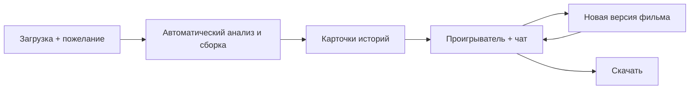
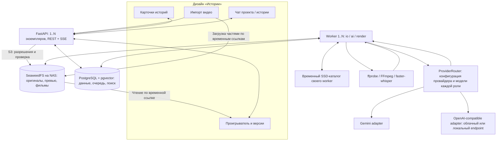

# VMerger: архитектура с возможностью масштабирования

Дата: 23 октября 2026. Статус: целевая архитектура; рабочая alpha реализует её ограниченный срез. См. [реализованный объём](implementation.md) и [фактическую локальную проверку](local-validation.md).

Основная БД: PostgreSQL + pgvector. Одна кодовая база с отдельными модулями; API и worker запускаются независимыми процессами и могут работать на разных хостах. На старте достаточно одного API и одного worker.

Принятое размещение: собственный сервер / NAS. Постоянные медиа хранятся в закрытом объектном хранилище SeaweedFS с S3 API. Компьютер пользователя нужен для загрузки и просмотра; после завершения загрузки обработка продолжается на сервере.

Подробные приложения: [агенты и монтажные эффекты](agents-and-effects.md), [валидация, мониторинг и тестирование](quality-and-operations.md), [метрики качества агентов и графики](agent-evaluation.md). Фактически выполненные проверки отдельно перечислены в [validation.md](validation.md); проектные требования не являются результатами тестов.

## 1. Зафиксированный продукт и дизайн

Используем выбранный дизайн «Истории»: спокойные зелёные акценты, большие обложки, светлая и тёмная темы. Пользователь загружает видео, получает автоматически собранные истории, смотрит их и задаёт правки в чате. Монтажные решения принимает система.

Три состояния интерфейса:

1. **Новый проект.** Загрузка файлов/папки и необязательное поле «Что это за видео и какой результат нужен?». Нужны только исходники: формат, число фильмов и длительность система может выбрать сама.
2. **Истории проекта.** Карточки с обложкой, названием, длительностью, кратким содержанием и фактическим статусом обработки. Общий чат управляет проектом: «Объедини море и горы», «Сделай отдельный фильм про поход».
3. **Просмотр истории.** Слева переключение историй, в центре проигрыватель, справа чат выбранной истории. Под проигрывателем — версии, сравнение версий и скачивание. На мобильном экране чат располагается под видео.

Перемещение клипов, таймлайн и ручная нарезка в пользовательский интерфейс не входят. Кнопки подсказок отправляют обычный текстовый запрос. Просмотр предыдущей версии сам по себе не делает её текущей; восстановление — отдельная команда.



## 2. Стек, доступ и размещение

| Компонент | Выбор | Ответственность |
|---|---|---|
| Интерфейс | React, TypeScript, Vite | Проекты, истории, чат, проигрыватель |
| API | Python, FastAPI, Pydantic | Аутентификация, команды, чтение состояния |
| Данные | PostgreSQL 18, SQLAlchemy, Alembic | Владельцы, проекты, версии, очередь |
| Поиск | pgvector >= 0.8.0, PostgreSQL FTS | Векторный и текстовый поиск внутри БД |
| Медиа | SeaweedFS с S3 API, boto3 | Приватные объекты на своём NAS/сервере |
| Обработка | Python worker, очереди io/ai/render | Загрузки, анализ, монтаж |
| Видео и речь | ffprobe, FFmpeg, faster-whisper | Метаданные, производные материалы, речь, рендер |
| AI | ProviderRouter: Gemini и OpenAI-совместимый HTTP API | Отдельные провайдеры и модели для анализа, творческих ролей и эмбеддингов |
| Обновления | REST + SSE | Прогресс, ответы и актуальное состояние |
| Наблюдаемость | OpenTelemetry, JSON-логи, Prometheus, Grafana, Alertmanager | Трассы операций, метрики, диагностика и алерты |
| Проверки | pytest, Hypothesis, Vitest, Playwright, k6 | Логика, интеграции, интерфейс, медиа и нагрузка |

Модули одной кодовой базы: identity/projects, media, catalog/search, editing/agents, jobs, provider adapters. API и worker используют общие модели и сервисные операции. Масштабируем количество процессов без копирования доменной логики в отдельные микросервисы.

На старте один API и один worker могут работать на одном сервере. SeaweedFS — на NAS либо на том же сервере. Если NAS слабый, обработка работает на отдельном CPU/GPU-хосте. Совместимость NAS с контейнерами/бинарниками проверяем перед установкой. PostgreSQL доступен по сети; его каталог данных находится на диске хоста БД, не в S3 или SMB/NFS-папке.

С первого выпуска проект имеет owner_id. users связывает UUID с проверенными issuer/subject провайдера входа; email не используется как постоянная идентичность. API проверяет подпись/issuer/audience/срок токена либо доверяет только защищённому шлюзу аутентификации, исключающему подмену заголовков. Вход в браузере — защищённая cookie с защитой изменяющих запросов от CSRF.

Каждый пользовательский запрос проверяет владельца проекта, включая поиск, SSE и подписанные ссылки. Составные FK с project_id защищают связи, но не авторизуют чтение. Клиентский owner_id не является доказательством доступа. Worker — доверенный внутренний процесс; браузер не получает его интерфейс, ключи БД или постоянные S3-ключи. Совместный доступ и project_members добавляются при появлении такого сценария.

API не хранит единственную копию сессии или состояния проекта в памяти процесса. При переподключении SSE клиент получает актуальный снимок jobs/stories/messages. В v1 API периодически читает изменения из PostgreSQL; LISTEN/NOTIFY можно добавить как ускорение, но не как гарантированный журнал. Переключение экземпляра API не теряет финальные ответы и версии.

Закрытие браузера не отменяет серверные задания. Незавершённая загрузка останавливается и может быть продолжена, при необходимости с повторным выбором файла. Транзакции БД не удерживаются во время AI, загрузок и рендера.

## 3. Схема компонентов



Оригиналы, уменьшенные копии и готовые фильмы постоянно находятся в собственном S3-хранилище. Для рендера worker получает нужные объекты во временный каталог на SSD сервера и затем удаляет рабочие копии. Выбранный AI-провайдер получает уменьшенное видео либо выборку кадров, описания и релевантную переписку. Для локального AI можно указать собственный совместимый endpoint; возможность анализа кадров и качество зависят от выбранной модели.

## 4. AI-провайдер и модели

Провайдер не является частью доменной логики. `ProviderRouter` выбирает адаптер и модель по роли из `config/ai.toml`, проверяет структурированный ответ и записывает единый аудит. Доступны Gemini и OpenAI-совместимые Chat Completions / Embeddings endpoints, в том числе локальные. Подробности настройки и ограничения: [Provider routing](providers.md).

Для творческих ролей реализована явная цепочка до двух резервов: внешний API, своя LLM или заранее запущенная LLM на Vast.ai через SSH/VPN. Переключение вызывают только временные ошибки inference; каждая попытка сохраняет фактический provider/model в `ai_calls`. Видеоанализ и embeddings меняются явно, чтобы сохранить возможности входных данных и идентичность векторного пространства. [Схема самостоятельного размещения](self-hosted-llm.md) также описывает следующий этап: отдельный controller аренды GPU с lease, бюджетом, readiness и idle TTL. Автоматический provisioning пока не реализован.

| Задача | Модель / инструмент | Вход → результат |
|---|---|---|
| Анализ содержимого | Маршрут `analyst`, модель с видео или изображениями | Видео / кадры с таймкодами → описания сцен |
| План и правки | `director`, `music`, `editor`, `reviewer`; модели независимы | Каталог и пожелания → проверяемый JSON плана |
| Поиск по смыслу | Маршрут `embedding`, 768 измерений | Текст сцен и запрос → векторы одного профиля |
| Распознавание речи | Нативное видео при поддержке модели; отдельный ASR — будущая работа | В режиме кадров поле речи обязано быть пустым |
| Выполнение монтажа | FFmpeg на своём сервере | Проверенный план + исходники → MP4 |

Пример конфигурации сохраняет Gemini как исходный вариант, но роли можно перевести на другие endpoints без изменения пайплайна. Одна попытка задания использует один снимок конфигурации; следующая читает обновлённый файл. Автоматического fallback на другого поставщика нет. Перед живым запуском проверяем доступность модели, форматы ответа, модальности и права на передаваемые материалы.

Векторизуем текстовый каталог сцен; Gemini использует `RETRIEVAL_DOCUMENT` / `RETRIEVAL_QUERY`, совместимый адаптер допускает префиксы модели для документов и запросов. Векторы нормализуем. Смена модели, совместимого endpoint или префиксов создаёт отдельный профиль. Переиндексация запускается явной командой «Обновить поиск», проходит через очередь, сохраняет старые профили и не требует повторного анализа видео. До заполнения профиля семантический поиск возвращает 409; полнотекстовый работает независимо.

В текущем alpha worker получает оригинал из S3 и создаёт временный proxy. Gemini получает его inline; совместимая vision-модель получает ограниченную выборку JPEG с временными отметками без аудио. Закрытый адрес NAS не передаётся как публичный URL. Chunking, внешние файловые API и управление их сроками хранения остаются развитием для больших материалов.

Границы интеграции:

```text
analyze_video(derivative, time_range, schema) -> observations
plan_stories(catalog, user_brief, constraints) -> proposed_stories
interpret_message(context, available_tools) -> operations
embed_documents(texts) -> vectors
embed_query(text) -> vector
```

Секрет API хранится на стороне backend, например в системном хранилище учётных данных или переменной окружения. В БД и браузер ключ не передаётся. Текст из видео и расшифровки — данные для анализа; команды на изменение проекта исходят из пользовательского чата.

### Агентные роли

Режиссёр формирует сценарий и выбирает сцены, музыкальный агент подбирает музыку, **монтажный агент** проектирует ритм, переходы, эффекты, титры и оформление. Рецензент оценивает фактическое превью. Роли запускаются по необходимости внутри существующих worker, используют ограниченные инструменты и общий бюджет; пользователь общается с одним чатом.

Монтажный агент ищет совместимые пресеты в каталоге, проверяет эффект на коротком фрагменте и возвращает изменение плана с ID и версиями эффектов. Рендер выполняет проверенный компилятор плана. Внешние медиа для оформления сохраняются в S3 с источником и условиями использования. Подробный поток, инструменты, хранение и ограничения описаны в [Агенты и монтажные эффекты](agents-and-effects.md).

## 5. Хранилища

### PostgreSQL — структурированные данные и векторы

В одной БД находятся пользователи, проекты, ссылки на медиа, планы, переписка, задания и эмбеддинги. Используем UUID, timestamptz, JSONB для различающихся метаданных и vector(768). Связи, статусы, идентификаторы и поля фильтрации — обычные столбцы. Весь проект в один JSON не помещаем. Поля updated_at обновляет сервис.

Пул соединений каждого процесса ограничен; сумма по экземплярам укладывается в бюджет PostgreSQL. Схема применяется ролью миграций; API/worker не владеют таблицами и не выполняют DDL. Для резервирования используем средства PostgreSQL с проверкой восстановления; при требовании малого RPO — base backup и архив WAL/PITR.

### SeaweedFS — постоянное хранилище медиа на NAS

Для первой установки выбираем **SeaweedFS в режиме одного узла**. Официальная документация описывает запуск через `weed mini` или контейнер; S3 API поддерживает multipart-загрузки, временные подписанные ссылки и чтение диапазонов. Конкретную версию образа закрепляем после проверки на выбранном NAS. Кластер для первого прототипа не требуется. [SeaweedFS](https://github.com/seaweedfs/seaweedfs), [поддержка S3 API](https://github.com/seaweedfs/seaweedfs/wiki/Amazon-S3-API).

Начинаем с одного приватного bucket `vmerger` и префиксов внутри него:

```text
s3://vmerger/
  originals/<project_id>/<object_id>
  derived/<project_id>/<object_id>
  renders/<project_id>/<object_id>
```

Это ключи объектов, а не пути, которые приложение открывает через файловую систему. Физически данные по-прежнему лежат на дисках NAS, но управляет ими сервис хранения. Приложение работает через S3 API и не зависит от внутренних каталогов SeaweedFS. Оригинальное имя и MIME-тип сохраняются в метаданных; исходные байты не перекодируются при импорте.

Конфигурация сервера связывает alias storage_backend с endpoint и настройками S3. Endpoint, регион, режим адресации и ссылка на секреты задаются на сервере; пароли не записываются в БД. `storage_objects` содержит `storage_backend`, `bucket`, `object_key`, назначение, статус, размер, SHA-256, ETag и время проверки. `assets`, `derivatives` и `renders` ссылаются на `storage_object_id`. Подписанные URL короткоживущие: выдаём их по запросу после проверки доступа, не используем как постоянные адреса в БД. ETag храним отдельно и не считаем SHA-256.

### Загрузка и публикация результата

1. API создаёт запись объекта с новым ключом и сессию в `upload_sessions`, затем начинает S3 multipart upload. Повтор запроса с тем же `request_id` возвращает ту же сессию; восстановление проверяет также отпечаток параметров запроса.
2. Браузер получает временные ссылки на конкретные части и отправляет байты прямо в SeaweedFS. Размер части рассчитывается из размера файла и лимита частей; начальный ориентир — 16–64 MiB. API выдаёт ссылки порциями, ограничивает размер/число частей и разрешённый ключ.
3. Сервис сверяет части через S3 `ListParts`, получает номера, размеры и ETag из S3, выполняет `CompleteMultipartUpload`. Сообщение браузера «готово» само по себе не подтверждает полноту загрузки. После обрыва догружаются отсутствующие части; после перезапуска браузер может потребовать повторно выбрать тот же файл. Проверяем размер и отпечаток. Для надёжной проверки продолжения сравниваем полный клиентский SHA-256 с хешем собранного объекта либо проверяем содержимое уже загруженных частей; одного имени недостаточно.
4. Worker проверяет фактический размер через `HEAD`, читает объект, вычисляет SHA-256 и проверяет контейнер через ffprobe. Если клиент передал ожидаемый SHA-256, сравнивает его. Объект получает статус `available`, создаётся `asset`, сессия получает результат. Размер и SHA-256 хранятся только в storage_objects. Ссылка на asset, завершение сессии и постановка analyze_asset фиксируются одной транзакцией. При совпадении хеша в том же проекте возвращаем существующий asset; лишний объект очищается после фиксации результата. Частичный уникальный индекс оригиналов защищает от одновременного импорта дублей; конфликт обрабатываем как дедупликацию.
5. Производные файлы и рендеры worker сначала создаёт и проверяет во временном каталоге сервера, затем загружает под новым ключом. После завершения загрузки проверяет размер и целостность сохранённого объекта; в v1 допускается контрольное чтение с вычислением хеша. Одной транзакцией публикует ссылку на объект и отмечает результат готовым. Незавершённый объект проигрывателю недоступен.

POST complete одной транзакцией переводит сессию в verifying и ставит verify_upload, отвечая 202. Задание сверяет/завершает multipart и проверяет объект; повторный complete возвращает прежнее состояние. POST abort ставит reconcile_storage для указанной сессии и отменяет её активную проверку. aborted означает подтверждённое прерывание S3, намерение отмены сохраняется в задании до выполнения операции.

Общей транзакции между S3 и PostgreSQL нет. Реестр объекта создаётся **до** записи байтов, ключ каждой новой попытки уникален. Повторное завершение загрузки сверяет состояние с S3: если объект уже существует, проверяет его, а не начинает загрузку заново. Периодическое задание восстанавливает зависшие состояния и убирает подтверждённые бесхозные объекты после защитного интервала. Незавершённые multipart-сессии прерываются через S3 API; неизвестные сессии, появившиеся при сбое между S3 и БД, также сверяются. Отметка задания как выполненного проверяет актуальность аренды worker. Атомарное переименование файлов не используется как гарантия публикации в S3.

Публикацию выполняет единый сервисный метод. Порядок блокировок: project → job → storage_object. Под блокировками проверяем active-проект, актуальный lease_token, проверенный объект, назначение и принадлежность. Затем фиксируем ссылки, результат и следующее задание одной транзакцией. Долгих сетевых операций в ней нет. Чтение готового рендера также требует available-объект. Уже опубликованные байты и ключи не изменяются — это сервисный контракт.

Для воспроизведения API выдаёт подписанный GET URL с ограниченным сроком. Клиент обновляет ссылку при истечении, сохраняя позицию просмотра. S3 endpoint должен быть доступен браузеру через LAN/VPN и HTTPS; внешнее имя для подписания и внутреннее имя для worker настраиваются отдельно. Нельзя просто заменить хост в уже подписанном URL. CORS разрешает только origin приложения и нужные операции/заголовки, включая чтение ETag при загрузке и Range при просмотре.

### Временные данные, удаление и резервные копии

Рабочий каталог worker имеет лимит места и привязан к `job_id`/попытке. Перед тяжёлой задачей проверяем доступное место. После завершения или отмены копии очищаются; после сбоя очистка учитывает действующие аренды. Очистка этого каталога не должна уничтожать постоянные оригиналы. На клиентском компьютере приложение не создаёт постоянную библиотеку медиа.

Производные материалы можно пересоздавать из оригиналов. Оригиналы и сохранённые экспорты не удаляются по TTL. При удалении проекта сначала фиксируем состояние `deleting`, блокируем новые загрузки, отменяем задания и multipart-сессии, дожидаемся остановки активных операций и истечения выданных разрешений на запись. Затем повторяем очистку объектов до подтверждения результата и только после этого удаляем строки проекта. Удаление строк PostgreSQL само по себе не удаляет S3-объекты.

Резервируем оригиналы, сохранённые экспорты и восстанавливаемую копию PostgreSQL на отдельный носитель/сервер. При резервировании внутреннего состояния SeaweedFS нужны и данные томов, и его метаданные; альтернативный путь — копия объектов через S3 с манифестом ключей и хешей. Копирование на второй каталог того же NAS не защищает от потери NAS. План бэкапа включает пробное восстановление проекта. Очистка учитывает окно хранения бэкапов: восстановленная БД должна ссылаться на сохранённые оригиналы.

### Поиск: pgvector и PostgreSQL FTS

Для стартового профиля gemini-embedding-001:text-v1:768 храним один нормализованный vector(768) на смысловой фрагмент. Карточка объединяет происходящее, обстановку, описание звука и относящуюся к диапазону речь. Вектор запроса вычисляется на время поиска. В таблице сохраняются модель, профиль подготовки текста и хеш текста.

Есть B-tree по project_id/profile_key и отдельный частичный HNSW-индекс стартового профиля. Для небольшой выборки проекта используем точный поиск с предварительным отбором. Для большой — HNSW с фильтрами и iterative_scan. Порог определяем измерениями на сервере. Примеры запросов с проверкой владельца — в worker-and-search.sql.

HNSW может пропускать ближайшие результаты. Проверяем recall@k относительно точного поиска, особенно с фильтрами по проекту; настраиваем глубину сканирования и при необходимости используем точный поиск или разбиение данных. [pgvector: фильтрация](https://github.com/pgvector/pgvector#filtering).

Смена модели создаёт новый профиль и отдельный индекс с фоновым заполнением; несовместимые пространства не смешиваем. Другая размерность требует миграции/отдельной таблицы, поскольку vector(768) фиксирован. Мультимодальные эмбеддинги — возможное расширение после оценки пропусков текстового поиска.

PostgreSQL FTS индексирует segments.search_text через generated tsvector и GIN. simple-конфигурация подходит для смешанного текста, но не обеспечивает русскую морфологию. Объединяем ранги FTS и векторных кандидатов, затем учитываем историю и ограничения. Если описания недостаточно, повторно анализируем фрагмент.

## 6. Таблицы: что упростили и что оставили

schema.sql создаёт пустую PostgreSQL с pgvector. Это новая исходная схема, не миграция существующей SQLite. Реальных пользовательских данных в приложении ещё нет; последующие изменения оформляем миграциями Alembic.

Предыдущая схема содержала 21 обычную таблицу и FTS-таблицу. Новая — 16 таблиц, включая добавленных пользователей. Упрощаем механизмы, а не пытаемся свести весь проект к одной записи.

| Убрали / изменили | Причина |
|---|---|
| events, event_segments, story_events | События пока промежуточный результат анализа. Группировку сохраняем в jobs.checkpoint, состав фильмов — в edit_versions.plan. Отдельный каталог событий понадобится только при таком пользовательском сценарии. |
| job_dependencies | Последовательность известных процессов описывается в коде и checkpoint, без универсального движка графов заданий. |
| upload_parts | Части подтверждает S3 ListParts, второй журнал состояния не нужен. |
| storage_locations | Для выбранного хранилища достаточно alias конфигурации и bucket у объекта. |
| Копии хеша/размера в assets, derivatives, renders | Эти свойства хранятся только у storage_objects. |
| Повторяющиеся триггеры публикации | Проверку и публикацию выполняет сервис под блокировками. SQL сохраняет FK/UNIQUE/CHECK и один триггер неизменяемости версий. |
| FTS5 и BLOB-векторы | Заменены на tsvector/GIN и pgvector. |

| Область | Таблицы | Содержимое |
|---|---|---|
| Владельцы и проекты | users, projects | Идентичность, владелец, пожелание, настройки |
| Медиа | storage_objects, assets, derivatives, upload_sessions | Объекты NAS, исходники, производные материалы и загрузки |
| Каталог | segments, transcript_spans, segment_embeddings | Диапазоны, описания, речь, векторы |
| Монтаж | stories, edit_versions, messages, renders | Фильмы, планы, чат и результаты |
| Выполнение | jobs | Очередь, попытки, аренды, checkpoint, отмена |
| Внешний AI | provider_files, ai_calls | Временные файлы, вызовы и расход |

Загрузки, реестр объектов, версии и задания сохраняем: они нужны для восстановления после обрыва, отмены и повторного запуска. Transcript_spans сохраняет фразы и слова с таймкодами независимо от меняющихся визуальных сегментов.

Все идентификаторы — UUID, даты — timestamptz, медийные диапазоны — BIGINT в микросекундах, полуинтервал [start_us, end_us). Неизвестную дату съёмки не заменяем датой импорта; исходный часовой пояс и происхождение даты храним в assets.metadata.

~~~mermaid
erDiagram
    USERS ||--o{ PROJECTS : owns
    PROJECTS ||--o{ STORAGE_OBJECTS : stores
    PROJECTS ||--o{ ASSETS : contains
    STORAGE_OBJECTS ||--o| ASSETS : original
    ASSETS ||--o{ DERIVATIVES : produces
    ASSETS ||--o{ SEGMENTS : contains
    ASSETS ||--o{ TRANSCRIPT_SPANS : speech
    SEGMENTS ||--o{ SEGMENT_EMBEDDINGS : indexed
    PROJECTS ||--o{ STORIES : contains
    STORIES ||--o{ EDIT_VERSIONS : versions
    EDIT_VERSIONS ||--o{ RENDERS : renders
    PROJECTS ||--o{ MESSAGES : chat
    PROJECTS ||--o{ JOBS : schedules
~~~

SQL не проверяет содержимое S3 и JSON-плана: диапазоны должны попадать в длительность исходника, ссылки плана принадлежать проекту, опубликованный объект быть проверен. Эти правила валидирует сервис. Сервисные контракты перечислены в конце schema.sql.

## 7. Канонический план монтажа

`edit_versions.plan` — источник правды для конкретной версии. Рендер всегда получает ID версии, а не подвижную ссылку «текущая история». Файлы JSON при экспорте являются копией данных БД.

```json
{
  "schema_version": 1,
  "output": {"width": 1920, "height": 1080, "fps_num": 30, "fps_den": 1},
  "clips": [
    {
      "clip_id": "occurrence_1",
      "segment_id": "segment_42",
      "asset_id": "asset_8",
      "source_in_us": 12400000,
      "source_out_us": 21800000,
      "audio_mode": "original"
    }
  ],
  "music": null,
  "transitions": []
}
```

`clip_id` — вхождение момента в этот фильм, `segment_id` — момент в исходнике. Результаты повторного анализа не меняют диапазоны сегментов, уже использованных в версиях: сохраняем новую разметку с новой идентичностью или явно сопоставляем её со старой.

Снимок `constraints` содержит обязательные/исключённые моменты, требования к звуку, длительности и стилю, а также ссылки на сообщения, откуда возникли правила. Снимки полные: история воспроизводится без повторного запроса к модели.

Пример выше показывает базовую версию контракта. Для агентного монтажа следующая версия контракта добавляет сценарий, стабильные ID экземпляров эффектов, версии и снимки пресетов, параметры, временные привязки, зависимости от медиа и профиль движка. Обновление сопровождается валидатором и миграцией формата; старые версии остаются читаемыми. Дизайн расширения приведён в agents-and-effects.md; текущая SQL-схема не реализует прикладную проверку этих полей.

## 8. Путь от загрузки до готовой истории

1. **Import:** загрузка оригинала частями в SeaweedFS, проверка размера/хеша/контейнера, создание `asset` со ссылкой на объект.
2. **Prepare:** временная рабочая копия на сервере; уменьшенные копии, обложки и звук публикуются в S3, карта времён — в БД.
3. **Transcribe + Analyze:** анализ звука и видео; эти этапы независимы и могут выполняться параллельно в дальнейшем.
4. **Index:** объединение наблюдений и речи, создание сегментов, FTS и эмбеддингов.
5. **Group:** группировка событий по времени, контексту и содержанию.
6. **Plan:** режиссёр предлагает истории и фрагменты; музыкальный и монтажный агенты подбирают звук и оформление. Управляющий процесс проверяет и сохраняет полную версию плана.
7. **Preview:** рендер уменьшенного MP4 и публикация в S3, техническая проверка и оценка рецензентом. Не более двух циклов творческой доработки; каждая доработка создаёт новую версию. Исходники полного качества используются при экспорте.
8. **Review by chat:** точечные изменения, новая версия и новый предпросмотр.

analyze_asset выполняет известную цепочку подготовки/анализа/индексации и возобновляется с checkpoint. build_project получает снимок списка asset_id; если анализ ещё идёт, под действующим lease_token возвращает задание в queued, переносит available_at, очищает аренду и компенсирует увеличение attempt при захвате. Плановое ожидание не расходует бюджет ошибок. Ошибка исходника явно завершает ожидание ошибкой; новые загрузки включаются новой командой сборки. Промежуточная группировка сохраняется в checkpoint, канонический состав фильма — в плане версии.

PySceneDetect используется как дополнительный сигнал о смене кадра. Для длинных непрерывных записей нужны окна и уточнение границ действий. Начальные параметры эксперимента: окна 30 секунд с перекрытием 3 секунды; параметры уточняются на тестовых материалах. Повторы из перекрытий объединяются по исходнику, времени и содержанию.

## 9. Протокол чата и версий

Клиент отправляет текст вместе с `project_id`, необязательным `story_id`, `context_version_id`, `playback_us` и уникальным `request_id`. Метка проигрывателя относится именно к показанной версии. Backend переводит её в исходник через план, учитывая переходы и изменение скорости.

API одной транзакцией сохраняет сообщение и apply_message. request_id вместе с отпечатком параметров защищает повтор: тот же запрос возвращает прежний результат, другой текст с тем же ID — конфликт. Worker при публикации блокирует историю, проверяет базовую версию и lease_token, назначает revision и одной транзакцией сохраняет версию/текущий указатель/задание рендера.

Модель получает релевантную переписку, текущий план, ограничения и найденные кандидаты. Ей доступны ограниченные инструменты поиска и изменения плана. Произвольные команды оболочки не нужны.

Пример операции после разрешения слов «убери дорогу» в конкретное вхождение:

```json
{
  "base_version_id": "version_3",
  "operations": [{"type": "remove_clip", "clip_id": "occurrence_9"}],
  "summary": "Убрана длинная сцена дороги"
}
```

Backend проверяет JSON и смысл операции, строит полный новый план, валидирует его, создаёт `edit_version` и атомарно меняет `stories.current_version_id`, только если базовая версия всё ещё актуальна. Устаревшая команда перепланируется или явно предлагается как ответвление. Повторный запрос с тем же `request_id` не создаёт вторую версию.

Результат рендера старой версии остаётся доступен в истории, но не переключает текущую версию. Пользователь видит реальные статусы «анализ», «сборка», «готово», «ошибка»; текст «готово» отправляется после проверки существования и воспроизведения файла.

## 10. Минимальный API

| Метод | Маршрут | Назначение |
|---|---|---|
| POST | `/projects` | Создать проект |
| POST | `/projects/{id}/uploads` | Начать загрузку оригинала, вернуть ID сессии |
| POST | `/uploads/{id}/part-urls` | Выдать временные ссылки на нужные части |
| GET | `/uploads/{id}` | Статус, сверенные части, результат импорта |
| POST | `/uploads/{id}/complete` | Поставить завершение multipart и проверку в очередь; ответ 202 |
| POST | `/uploads/{id}/abort` | Запросить прерывание загрузки и очистку; ответ 202 |
| POST | `/projects/{id}/build` | Сборка по снимку исходников |
| GET | `/projects/{id}/stories` | Карточки историй с пагинацией |
| GET | `/stories/{id}` | История и текущая версия |
| GET | `/stories/{id}/versions` | История изменений с пагинацией |
| POST | `/projects/{id}/messages` | Сообщение в контексте проекта или истории |
| POST | `/stories/{id}/exports` | Экспорт выбранной версии |
| POST | `/jobs/{id}/cancel` | Запросить отмену |
| GET | `/projects/{id}/events` | Поток SSE для статусов и ответов |
| GET | `/renders/{id}/media` | Подписанный URL готового объекта и срок действия; S3 обслуживает HTTP Range |
| DELETE | `/projects/{id}` | Асинхронное удаление с очисткой S3; ответ 202 |

Каждый маршрут проходит аутентификацию. API самостоятельно определяет bucket и ключ по ID объекта; клиент не может запросить произвольный S3-ключ. Аналогичный маршрут выдаёт ссылки на обложки. Выдача URL не делает bucket публичным. Endpoint выдачи ссылок возвращает `Cache-Control: no-store`, а подписанные URL не попадают в обычные журналы приложения.

Асинхронные изменяющие команды принимают request_id и проверяют отпечаток параметров. Для загрузок/сообщений это отдельные поля, для остальных — jobs.dedupe_key и отпечаток input. Повтор ID с другим содержимым возвращает конфликт. Пагинация использует курсор времени/UUID и ограниченный размер страницы.

## 11. Несколько worker, очередь и кэш

jobs в PostgreSQL — постоянная очередь. Примеры захвата, heartbeat и возврата аренд находятся в worker-and-search.sql. API и worker подключаются к общей БД с разных хостов; локальные рабочие каталоги не разделяются между машинами.

1. Worker выбирает свои очереди (io/ai/render) короткой транзакцией с FOR UPDATE SKIP LOCKED. Получает новый lease_token и ограниченный срок аренды.
2. Периодически продлевает аренду коротким запросом. Время берём у PostgreSQL. Потеря аренды запрещает публикацию: старый процесс не должен перезаписать новую попытку.
3. Результат, завершение задания и следующие задания записываются одной транзакцией. Доставка допускает повторы; UNIQUE/dedupe_key и проверка lease_token защищают публикацию. Exactly once для внешних AI/S3-вызовов не обещаем.
4. Истёкшие аренды возвращаются в очередь с задержкой либо завершаются failed при исчерпании попыток. cancel_requested останавливает дочерние процессы и запрещает публикацию частичного результата.
5. Известные процессы — verify_upload, analyze_asset, build_project, apply_message, render_version, reconcile_storage, delete_project. Checkpoint хранит этап, отпечатки и ID готовых результатов. Универсальный граф зависимостей не нужен.
6. Рендер и AI получают отдельные пулы процессов/слоты при росте нагрузки. До увеличения числа экземпляров рассчитываем общий параллелизм и лимиты провайдера: локальный лимит одного worker не является глобальным.
7. Вводим ограничения размера загрузки и числа активных задач на проект/владельца. При росте числа пользователей добавляем справедливое распределение и общий лимитер; измеряем возраст очереди по владельцам.

Сверка S3/БД и очистка выполняются worker. На отказ NAS отвечаем повтором с задержкой, не удалением записи. Scratch-каталог привязан к заданию/попытке, имеет лимит и очищается с учётом активных аренд. Сетевые операции и FFmpeg никогда не удерживают транзакцию БД.

Ключ кэша включает хеш входа, диапазон, версию этапа, модель, настройки и промпт; рендер — ещё план/профиль/движок. Изменение музыки не запускает анализ видео. Кэш используется только при доступном проверенном S3-объекте.

Логи содержат request_id/project_id/job_id, attempt и trace_id, но не секреты, подписанные URL и пользовательские медиа. OpenTelemetry связывает запрос, постановку задания, этапы worker и обращения к зависимостям. В ai_calls сохраняем фактические токены и время; неизвестное остаётся NULL. Оценка стоимости требует версии тарифов.

Prometheus собирает задержки, ошибки, возраст очередей, аренды, прогресс рендера, ресурсы PostgreSQL/NAS и расход AI; Grafana показывает состояние, Alertmanager доставляет сгруппированные алерты. ID проектов/пользователей/заданий остаются в закрытых логах и трассах, не в labels метрик. На одном хосте логи ограничиваются ротацией; централизованные Loki и Collector/Tempo подключаются при необходимости. Отказ телеметрии не блокирует обработку. Условия алертов, health endpoints, хранение и стартовые цели сервиса описаны в quality-and-operations.md.

## 12. Валидация, тесты и допуск к выпуску

Полный контракт: [Валидация, мониторинг и тестирование](quality-and-operations.md). Проверки добавляются вместе с каждым этапом разработки; только технически проверенный объект может получить статус ready.

Обязательные границы валидации: запрос/доступ → загрузка и хеш → анализ и эмбеддинги → инструменты агента → монтажный план → рендер → публикация. Отчёт содержит версию валидатора, fingerprint входа, SHA-256 результата при наличии файла и замечания. Проверка публикации связывает отчёт с точной версией, объектом и действующей арендой; успешный ответ модели не заменяет проверку.

Дополнительно для серверной схемы: подмена владельца/project_id, поиск чужих векторов, повтор request_id с иным содержимым, несовместимые профили эмбеддингов. На настоящем PostgreSQL с несколькими соединениями проверяем SKIP LOCKED, истечение аренды, публикацию старым worker, две одновременные правки и удаление во время публикации. HNSW сравниваем с точным поиском по recall@k; численные пределы нагрузки определяем тестами.

Обязательные технические проверки: валидность диапазонов, принадлежность файлов проекту, соблюдение закреплений/исключений, длительность с учётом переходов, отсутствие обрыва речи на выбранных границах, синхронизация звука и изображения, воспроизводимый экспорт из сохранённой версии.

Тестовый набор должен включать вертикальные видео, переменную частоту кадров, отсутствие звука, длинные непрерывные записи, дубли, неточные даты и смешанные события. Проверка содержания проводится на человеческой оценке: автоматический валидатор не может гарантировать художественное качество.

Хранилище проверяем отдельно: продолжение multipart после обрыва, повтор `complete`, падение между записью в S3 и фиксацией в БД, неверный размер/хеш, отказ NAS, заполненный scratch-диск, истечение URL во время просмотра, отмена с активной загрузкой и восстановление из резервной копии. На закреплённой версии SeaweedFS выполняем интеграционные проверки S3, CORS, подписанных ссылок и Range; SQL-проверки их не заменяют.

Стратегия: pytest для backend, Hypothesis для диапазонов и состояний, Vitest для frontend, Playwright для сценария загрузка → фильм → чат → экспорт, k6 для нагрузки. В интеграциях работают настоящий PostgreSQL/pgvector, SeaweedFS и FFmpeg; AI подменяется в обычном CI и отдельно проверяется на ограниченных реальных прогонах. Правила мониторинга получают тесты promtool и проверку доставки алертов.

Начальные пороги выпуска: backend ≥ 80% строк / 75% ветвей; критическая логика доступа, публикации, аренд, версий, плана и бюджета ≥ 90% строк и ветвей; frontend ≥ 80% строк / 70% ветвей. Это цели будущей реализации, не измеренное покрытие. Критические сценарии обязательны независимо от процента. Для агентов используется отдельный контрольный набор с оценкой соблюдения пожеланий, качества, времени и стоимости; оценка рецензента не является единственным критерием.

CI блокирует выпуск при нарушении инвариантов, регрессии, недостаточном покрытии или неуспешной миграции. Перед выпуском дополнительно проверяются нагрузка, воспроизведение сохранённых версий, доставка алерта и восстановление проекта из независимого бэкапа. Ранее выполнены 31 условие в одном соединении PGlite; ограничения этих результатов описаны в validation.md.

## 13. Масштабирование по измерениям

| Нагрузка | Следующий шаг |
|---|---|
| Не хватает HTTP/SSE-соединений | Дополнительные API за балансировщиком, общий доступ к состоянию |
| Долго ждём анализ или рендер | Worker нужной очереди на отдельных CPU/GPU-хостах |
| Поиск стал медленным | План запроса, настройка HNSW и фильтров, проверка recall; затем разбиение данных |
| Поиск конкурирует с транзакциями | Бюджеты ресурсов; при необходимости отдельный поисковый сервис с журналом синхронизации |
| Очередь перегружает PostgreSQL | Брокер + transactional outbox; PostgreSQL сохраняет состояние заданий |
| Не хватает ёмкости/доступности NAS | Расширение/репликация SeaweedFS, независимый бэкап и проверенный failover |
| Нужен совместный доступ | project_members и роли поверх users/owner_id |

У каждого процесса ограниченный пул соединений; сумма укладывается в бюджет PostgreSQL. PgBouncer добавляем при необходимости и проверяем совместимость режима пула. Исчезновение процесса API/worker не теряет сохранённое состояние.

Готовность API/worker к нескольким экземплярам не обеспечивает отказоустойчивость одиночной БД и NAS — это отдельные задачи развёртывания. Redis, Kubernetes, отдельную векторную БД и шардирование в первую установку без измеренной причины не включаем.

## 14. Порядок реализации

1. PostgreSQL + pgvector, SeaweedFS на своём сервере/NAS, идентичность и владельцы, загрузка с продолжением; валидаторы доступа/импорта, логи, метрики и первые интеграционные тесты.
2. Задания с арендой, проверяемый FFmpeg-рендер фиксированного плана и публикация результата в S3; тесты гонок и медиа, дашборды, алерты и проверка доставки.
3. Каталогизация видео/речи и поиск моментов; контрольная разметка, оценка релевантности и ANN recall.
4. Автоматическое создание событий, историй и первой версии: режиссёр, музыкальный и монтажный агенты, стартовый каталог совместимых эффектов, ограниченный цикл оценки превью; бюджет, журнал инструментов и контрольный AI-набор.
5. Чат с операциями над планом, ограничениями и откатом; проверки идемпотентности, версий и сквозных сценариев.
6. Интерфейс «Истории», устойчивость к сбоям и оценка качества на реальных поездках; допуск к выпуску по CI, нагрузке, восстановлению и эксплуатационным пределам.

Критерий первого готового сценария: загрузить подборку, получить один или несколько фильмов, изменить их сообщениями «короче», «убери», «оставь целиком» и вернуться к предыдущей версии без ручного монтажа.

## Источники

- [SeaweedFS: запуск на одном узле и в контейнере](https://github.com/seaweedfs/seaweedfs)
- [SeaweedFS: совместимость S3, multipart, подписанные ссылки](https://github.com/seaweedfs/seaweedfs/wiki/Amazon-S3-API)
- [Gemini 3.8 Flash: видео, function calling, structured outputs](https://ai.google.dev/gemini-api/docs/models/gemini-3.8-flash)
- [Gemini video understanding](https://ai.google.dev/gemini-api/docs/video-understanding)
- [Gemini structured outputs и необходимость прикладной валидации](https://ai.google.dev/gemini-api/docs/structured-output)
- [Gemini embeddings: модели, размерности, нормализация и режимы поиска](https://ai.google.dev/gemini-api/docs/embeddings)
- [Gemini Files API: временное хранение загруженных файлов](https://ai.google.dev/gemini-api/docs/files)
- [faster-whisper: пословные таймкоды](https://github.com/SYSTRAN/faster-whisper)
- [PostgreSQL: SELECT и SKIP LOCKED](https://www.postgresql.org/docs/current/sql-select.html)
- [PostgreSQL: резервирование](https://www.postgresql.org/docs/current/backup.html)
- [pgvector](https://github.com/pgvector/pgvector)
- [FFmpeg filters](https://www.ffmpeg.org/ffmpeg-filters.html)
- [PySceneDetect](https://www.scenedetect.com/docs/latest/)
