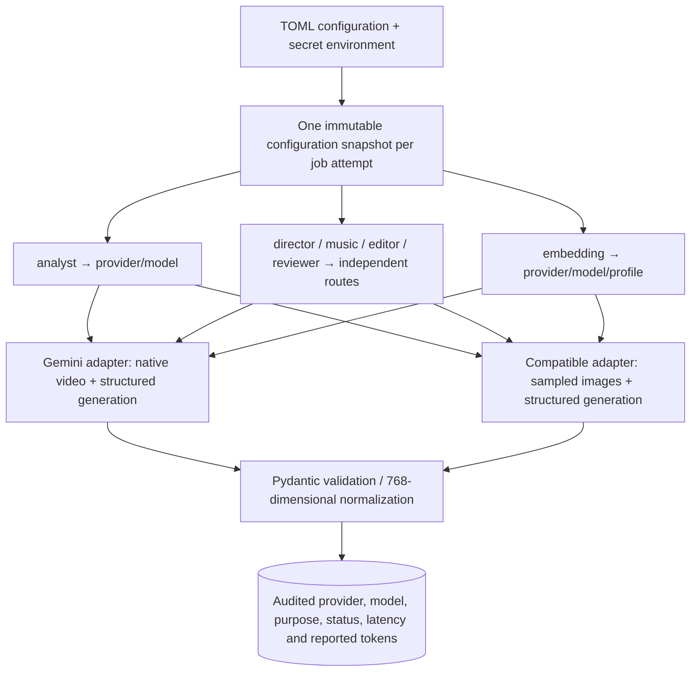

# Provider routing and model switching

The pipeline calls `ProviderRouter.analyze`, `call` and `embed`. Adapters translate provider HTTP/SDK formats; the router owns schema validation, vector normalization and the common `ai_calls` audit. No provider-specific client appears in agent orchestration.



## Configuration

The default path is `config/ai.toml`, overridden with `AI_CONFIG_FILE`. Provider names (`google`, `gateway`, `local`, etc.) are your labels, not an enum. Each provider chooses an adapter: `gemini` or `openai_compatible`. Unknown roles, adapter names, missing embedding routes and invalid references fail configuration validation. `/api/config` returns configured roles without endpoints or keys; configured does not mean that a live connection has been tested.

Each creative role inherits `[default]` unless overridden. Analysis and embeddings have explicit routes in the shipped file. Model IDs are configuration values and must exist on the selected endpoint; example IDs are not availability guarantees.

| Field | Purpose |
|---|---|
| `api_key_env` | Name of the environment / `.env` variable holding the secret |
| `base_url` | Compatible endpoint root, including `/v1` if required; no query, embedded credentials or fragment |
| `allow_no_key` | Explicitly allow an unauthenticated local compatible server; defaults to false |
| `response_format` | `json_schema` (non-strict provider schema plus mandatory local validation) or `json_object` |
| `token_parameter` | `max_completion_tokens` or `max_tokens`, according to the endpoint/model |
| `send_dimensions` | Send `dimensions: 768` for embeddings; disable only when the chosen model naturally returns 768 values |
| `document_prefix` / `query_prefix` | Optional model-specific retrieval prefixes, included in the compatible embedding profile identity |
| `frame_samples` | Root setting, 2–24 timestamped images; default 12 |
| `max_output_tokens` | Root output token limit, default 12000 |

For a local compatible server, for example:

```toml
[providers.local]
adapter = "openai_compatible"
base_url = "http://127.0.0.1:8001/v1"
api_key_env = "LOCAL_AI_KEY"
allow_no_key = true
response_format = "json_object"
token_parameter = "max_tokens"
send_dimensions = false

[routes.editor]
provider = "local"
model = "your-loaded-chat-model"
```

From a container, `127.0.0.1` means that container, so use the inference service's reachable hostname instead. A local vision model can also be assigned to `analyst`; a text-only model cannot analyze frames. An embedding model must support the Embeddings endpoint and the current 768-dimensional schema. Providers with a different native API need another adapter; they are not automatically supported by renaming a model.

Configuration is loaded when a job attempt starts, and each router holds that snapshot throughout the attempt. Fallback is disabled unless explicitly configured for a creative role. A retry starts a new attempt with current configuration. Config file edits need no rebuild; environment/secret changes require restarting API and worker. Replace config files atomically during deployment to avoid reading partially written TOML. An invalid file disables AI availability without disabling uploads or playback.

Legacy installations can explicitly set `settings.ai_config_file=None` programmatically to use the old Gemini settings; normal deployments use TOML. `GEMINI_MODEL` and `EMBEDDING_MODEL` do not override configured TOML routes.

## Explicit failover and self-hosted models

Any compatible endpoint can be hosted on your own GPU or a rented GPU. No hosted-API account is required for creative roles when their routes point to your own inference server. See [self-hosting and Vast.ai](self-hosted-llm.md) for network setup and a complete configuration.

```toml
# Both provider names must already exist in [providers.*].
[fallbacks]
director = [{provider = "local", model = "vmerger-planner"}]
editor = [{provider = "local", model = "vmerger-planner"}]
```

Lists are per role, ordered, and capped at two backups. A route cannot repeat the primary or another backup. Only `director`, `music`, `editor` and `reviewer` support fallback. A transient inference failure (network/timeout, 429 or 5xx) advances to the next route. Authentication/configuration errors, other 4xx, invalid output, refusals, truncation and audit/database errors propagate immediately. A valid reviewer rejection remains a rejection. Exhaustion raises a retryable job error; every new call starts at its primary, without a shared circuit breaker.

Each attempt has its own `ai_calls` row and target-specific fingerprint, including failed primaries. `/api/config` and the AI team view list fallback providers/models and credential readiness without endpoints or keys. Availability flags describe primary configuration; a missing backup key is shown separately and fails if that backup is reached. Backups are never silently skipped. Adding a destination explicitly permits sending that role's inputs to it.

Analyst fallback is rejected because native-video and image-sampling capabilities differ. Embedding fallback is rejected because a different model must not silently change vector space. These routes can still be changed explicitly using the documented capabilities and reindex flow. GPU startup, rental, teardown and cost caps are not part of the inference router.

## Video capabilities

| Adapter | Sent for analysis | Limitation |
|---|---|---|
| Gemini | Reduced MP4 proxy with available audio, inline | Existing 14 MB proxy cap; source-bound and schema validation still required |
| Compatible | Uniform JPEG samples with source timestamps | Requires a vision model; no audio, no speech transcription, short events and precise boundaries may be missed |

The frame adapter rejects nonempty speech output rather than storing invented transcripts. It does not claim quality parity with native video analysis. No live model quality has been measured for either adapter in this change.

## Embedding profiles and reindexing

The Gemini profile retains the existing `model:text-v1:768` identity for compatibility. Compatible profiles include the adapter, endpoint identity, model and retrieval prefixes. Credentials and provider display aliases do not change the vector space. Changing model weights behind an unchanged endpoint/model ID requires a new model ID in configuration.

`POST /api/projects/{id}/embeddings/reindex` creates a durable, project-scoped job. Repeated requests deduplicate active work for the same profile. The worker embeds missing scene texts in batches of 32, checks its lease before each publication and preserves old profiles. A retry skips already published batches. A queued reindex fails if its requested profile no longer matches configuration.

Semantic search returns HTTP 409 while any scene lacks the selected profile. It never compares vectors across profiles, even if their dimensions match. Full-text search still works. Switching planning or analysis models does not require embedding reindexing and does not rewrite existing edit versions. Existing analyzed source scenes are immutable; this operation re-embeds their text rather than rerunning video analysis.

The current database supports `vector(768)`. Other dimensions require a schema/index migration. The initial HNSW index is partial for the original Gemini profile; other profiles use the scoped exact search path until workload-specific indexes are added and measured.

## Verification and reference contracts

Offline tests exercise mixed endpoints and role models, schema errors, refusals, truncated answers, embedding indexes/dimensions/prefixes, HTTP failures and secret-free audits. Integration tests use real PostgreSQL, S3 and FFmpeg for profile switching, reindex deduplication, old-profile preservation and JPEG extraction. API transports are fixtures, not paid network calls.

The compatible wire formats follow the official [Chat Completions reference](https://developers.openai.com/api/reference/python/resources/chat/subresources/completions/methods/create) and [Embeddings reference](https://developers.openai.com/api/reference/resources/embeddings/methods/create). Compatibility of a particular third-party endpoint must be checked against its own implementation.
