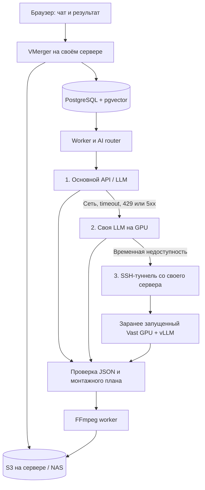
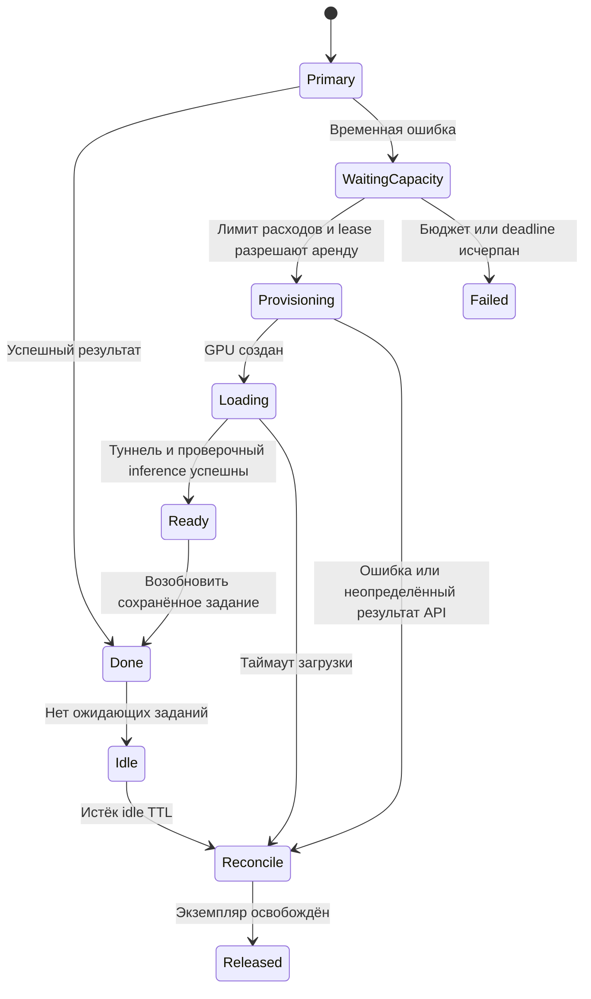

# Своя LLM и резервный GPU на Vast.ai

VMerger может обращаться к внешнему API, к модели на своём GPU или к модели на арендованном GPU. Для совместимого сервера меняются `base_url`, модель и имя переменной с ключом; агенты и монтажный pipeline остаются общими. NAS может хранить медиа, а inference выполнять отдельная машина.

**Реализовано:** подключение совместимого endpoint и последовательный fallback для четырёх творческих ролей на уже работающие серверы. **Проектируется:** автоматическая аренда GPU, ожидание загрузки модели и освобождение аренды. В репозитории нет клиента управления Vast.ai, и приложение не создаёт платные ресурсы.

## Как соединяются компоненты



Запросы к моделям идут от worker. Браузер не получает ключи inference-сервисов. Оригиналы и готовые ролики остаются в S3; при использовании удалённого GPU туда уходят входные данные выбранных ролей, например текст сцен и запрос пользователя. SSH шифрует соединение, но сам inference выполняется на арендованном оборудовании.

## Запуск модели

В качестве сервера можно использовать **vLLM** с Chat Completions API. Выберите совместимую instruct/chat-модель, проверьте её лицензию, поддержку JSON и размер контекста. Версию vLLM и ревизию весов фиксируйте в своей конфигурации развёртывания. GPU/VRAM подбираются под веса, контекст и параллелизм, а не только под число параметров.

На Linux GPU-машине с установленным vLLM, совместимым CUDA runtime и заданными `MODEL_ID` и секретом `VLLM_API_KEY`:

```sh
vllm serve "$MODEL_ID" \
  --served-model-name vmerger-planner \
  --host 127.0.0.1 --port 8000
```

В конфигурации VMerger используйте `model = "vmerger-planner"`, `token_parameter = "max_tokens"`. Ключ из `VLLM_API_KEY` должен совпадать со значением `OWN_LLM_KEY` или `VAST_LLM_KEY` на сервере VMerger. Эти ключи относятся к inference, **не к API аренды Vast.ai**. Если endpoint поддерживает только JSON object, задайте `response_format = "json_object"`; локальная проверка Pydantic обязательна в обоих режимах.

Порт vLLM оставьте за SSH/VPN или аутентифицирующим прокси. Его `--api-key`/`VLLM_API_KEY` не защищает все маршруты HTTP-сервера. Команда, API и ограничение аутентификации описаны в [официальном руководстве vLLM](https://docs.vllm.ai/en/stable/serving/online_serving/openai_compatible_server/).

Текстовая LLM подходит для `director`, `music`, `editor`, `reviewer`. Для `analyst` нужна vision-модель, принимающая JPEG; текущий совместимый адаптер не передаёт звук. Для `embedding` нужен отдельный совместимый embedding endpoint с 768 значениями, который задаётся явно. Таким образом, полностью локальная установка возможна, но один текстовый endpoint не заменяет все три возможности.

## Vast.ai через свой сервер

1. В своей учётной записи выберите GPU с подходящей памятью, зафиксируйте образ/версию runtime, задайте диск под веса и добавьте SSH public key. Для первоначальной проверки используйте заранее запущенный экземпляр. Выбор модели и оценка качества требуют отдельного прогона на ваших материалах.
2. Запустите vLLM внутри GPU-окружения, как выше. Возьмите SSH host, port и user из карточки экземпляра; адрес inference не нужно публиковать в Интернет.
3. На сервере VMerger откройте туннель. Команда ниже рассчитана на **нативный worker на той же машине**, где запущен SSH:

```sh
ssh -N \
  -o ExitOnForwardFailure=yes -o ServerAliveInterval=30 -o ServerAliveCountMax=3 \
  -L 127.0.0.1:18000:127.0.0.1:8000 \
  -p <SSH_PORT> <SSH_USER>@<SSH_HOST>
```

Проверьте fingerprint SSH-хоста при первом подключении. Для постоянной работы туннель должен запускаться сервисом с перезапуском после обрыва. В нативном VMerger `base_url = "http://127.0.0.1:18000/v1"`. Механика подключения и forwarding описаны в [SSH-документации Vast.ai](https://docs.vast.ai/guides/instances/connect/ssh).

**В Docker Compose** loopback принадлежит контейнеру. Запустите SSH-клиент отдельным сервисом `vast-tunnel` в той же приватной Docker-сети, что API/worker; внутри него используйте `-g -L 0.0.0.0:18000:127.0.0.1:8000`, без публикации `ports` на хост. Смонтируйте выделенный SSH key и проверенный `known_hosts` только в этот сервис. Тогда URL — `http://vast-tunnel:18000/v1`. Аналогичный `own-gpu-tunnel` соединяет worker с собственным GPU. Эти сервисы нужно добавить в своё развёртывание: базовый Compose их автоматически не создаёт.

Перед включением маршрута проверьте из сети worker авторизованный `GET /v1/models`, затем небольшой `POST /v1/chat/completions` с выбранной моделью и JSON-схемой. Список моделей и открытый TCP-порт сами по себе не доказывают, что модель загружена и принимает нужный формат. Такие проверки выполняются владельцем; текущая локальная валидация проекта использует HTTP fixtures.

## Настройка маршрутов и резервов

Полный шаблон: [config/ai.hybrid.example.toml](../config/ai.hybrid.example.toml). Он показывает внешний API → свой GPU → Vast GPU. Замените адреса и модели, сохраните рабочий файл как `config/ai.toml` либо задайте `AI_CONFIG_FILE=config/ai.hybrid.example.toml`. Добавьте указанные ключи в `.env` и пересоздайте API/worker после изменения окружения.

Чтобы сделать собственную LLM основной, укажите `own_gpu` в `[default]`, модель `vmerger-planner`, а в каждом списке резервов оставьте только `vast_gpu`. Для полного отсутствия внешних API дополнительно задайте собственные vision- и embedding-маршруты. В шаблоне они пока указывают на внешний сервис.

```toml
# Добавляется к конфигурации, где own_gpu и vast_gpu уже определены.
[default]
provider = "own_gpu"
model = "vmerger-planner"

[fallbacks]
director = [{provider = "vast_gpu", model = "vmerger-planner"}]
music = [{provider = "vast_gpu", model = "vmerger-planner"}]
editor = [{provider = "vast_gpu", model = "vmerger-planner"}]
reviewer = [{provider = "vast_gpu", model = "vmerger-planner"}]
```

Для каждого вызова проверяется основной маршрут, затем максимум два резерва по порядку. Переключение допускают только сетевые сбои, timeout и HTTP 429/5xx. Ошибки ключа, 4xx кроме 429, отказ модели, обрезанный ответ, некорректный JSON и ошибки БД останавливают вызов. Отказ reviewer в утверждении плана также остаётся отказом; другая модель не вызывается в поисках одобрения.

Пустой список означает отсутствие fallback. Для `analyst` резерв пока запрещён из-за разных возможностей видео/аудио; для `embedding` — из-за несовместимых векторных пространств. Их изменение выполняется явно, при смене embedding-профиля нужна переиндексация. При исчерпании временно недоступных резервов ошибку получает существующий механизм retry задания. Каждый новый вызов снова начинает с основного маршрута: общего circuit breaker пока нет.

## Наблюдаемость

Вкладка **Качество → AI-команда** показывает основные маршруты, порядок резервов и наличие их ключей. Это конфигурация, а не проверка доступности. `ai_calls` сохраняет отдельную строку для каждой попытки: фактический provider/model, роль, статус, длительность и известные токены. Ошибка основного API остаётся в аудите, даже если резерв успешно ответил. График задержек считает попытки, а существующий счётчик ошибок провайдера включает неудачные обращения перед успешным резервом; это не число проваленных пользовательских заданий.

Для будущего контроллера нужны отдельные метрики: доля заданий, восстановленных резервом; частота переключений по причинам; p95 загрузки модели; доля успешных запусков GPU; время простаивания и стоимость аренды. Их пока нет в dashboard: потребуются идентификатор логического вызова, события переключения и данные биллинга.

## Автоматическая аренда при сбое — следующий этап



Это отдельный инфраструктурный controller, а не инструмент творческого агента. Он хранит в PostgreSQL профиль модели, request/instance ID, состояние, lease, deadline, лимит цены и idle TTL. Один lease на профиль предотвращает конкурирующую аренду десятью workers. При неизвестном результате запроса сначала сверяются экземпляры по тегу запроса; повторная покупка не выполняется вслепую. Секрет Vast хранится только у controller.

Controller проверяет актуальную цену, GPU/VRAM, фиксированную ревизию образа и весов, лимит экземпляров и общий бюджет. Ожидающий job освобождает worker и возобновляется после readiness. Загрузка весов может занять дольше обычного запроса, поэтому не должна происходить внутри текущего 120-секундного transport timeout. Watchdog находит зависшие аренды после перезапуска и освобождает их по TTL; Prometheus показывает ошибки provisioning и затраты.

На Vast остановленный экземпляр продолжает оплачивать хранение, поэтому завершение сценария должно включать контролируемое удаление ненужного экземпляра, а не только stop. Цены GPU, диска и трафика проверяются в момент аренды: [правила биллинга Vast.ai](https://docs.vast.ai/guides/pricing). Автоматическая аренда, бюджетный controller и этот жизненный цикл **не реализованы и не проверены на реальном GPU**.
