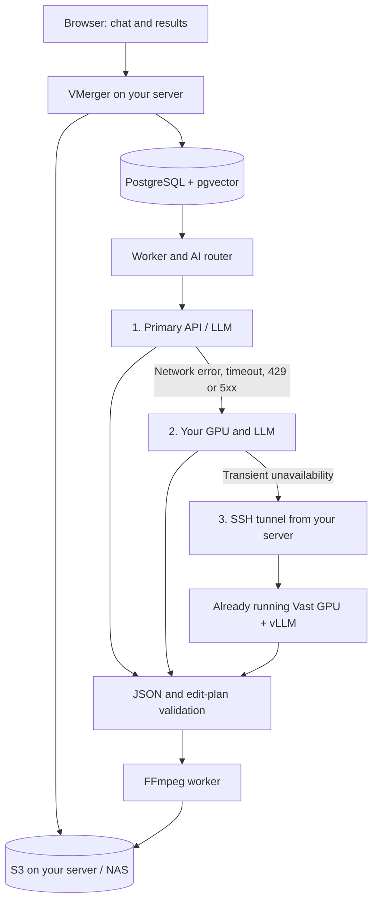

# Self-hosted LLMs and a backup GPU on Vast.ai

VMerger can call a hosted API, a model on your own GPU, or a model on a rented GPU. A compatible server only requires a different `base_url`, model and credential variable; agents and the editing pipeline remain shared. A NAS can store media while a separate machine performs inference.

Backups must already be running. VMerger does not provision, rent or release GPUs; manage that lifecycle outside the application.

## Connections



Workers send model requests. The browser receives no inference credentials. Originals and completed films stay in S3; remote GPUs receive the selected roles' inputs, such as scene text and user requests. SSH encrypts the connection, but inference still executes on rented hardware.

## Serving a model

**vLLM** can provide the compatible Chat Completions server. Choose a supported instruct/chat model and check its license, JSON support and context capacity. Pin the vLLM version and weight revision in your deployment. GPU memory depends on weights, context and concurrency, not parameter count alone.

On a Linux GPU machine with vLLM, a compatible CUDA runtime, `MODEL_ID` and secret `VLLM_API_KEY` configured:

```sh
vllm serve "$MODEL_ID" \
  --served-model-name vmerger-planner \
  --host 127.0.0.1 --port 8000
```

Configure VMerger with `model = "vmerger-planner"` and `token_parameter = "max_tokens"`. Its `OWN_LLM_KEY` or `VAST_LLM_KEY` must match the server's `VLLM_API_KEY`. These are **inference keys, not Vast.ai rental API keys**. If the endpoint only supports JSON objects, set `response_format = "json_object"`; local Pydantic validation remains mandatory in either mode.

Keep vLLM behind SSH/VPN or an authenticating proxy. `--api-key`/`VLLM_API_KEY` does not protect every HTTP route. Commands, API support and authentication limits are documented in the [official vLLM guide](https://docs.vllm.ai/en/stable/serving/online_serving/openai_compatible_server/).

Text LLMs support director, music, editor and reviewer roles. The analyst needs a vision model accepting JPEGs; the current compatible adapter sends no audio. Embeddings need an explicitly configured embedding endpoint returning 768 values. A fully local deployment is possible, but one text-only endpoint does not provide all three capabilities.

## Connecting Vast.ai through your server

1. In your account, select sufficient GPU memory, pin the runtime image/version, allocate disk for weights and add an SSH public key. Begin with an already running instance. Model selection and quality need separate evaluation on your material.
2. Start vLLM inside the GPU environment as above. Get SSH host, port and user from the instance card. The inference port need not be public.
3. Open a tunnel from the VMerger server. This example assumes a **native worker on the same host as the SSH client**:

```sh
ssh -N \
  -o ExitOnForwardFailure=yes -o ServerAliveInterval=30 -o ServerAliveCountMax=3 \
  -L 127.0.0.1:18000:127.0.0.1:8000 \
  -p <SSH_PORT> <SSH_USER>@<SSH_HOST>
```

Verify the SSH host fingerprint on first connection. For persistent operation, manage the tunnel as a service that restarts after interruption. Native VMerger uses `base_url = "http://127.0.0.1:18000/v1"`. See [Vast.ai SSH and forwarding](https://docs.vast.ai/guides/instances/connect/ssh).

**In Docker Compose**, loopback belongs to each container. Run an SSH client service named `vast-tunnel` on the API/worker's private Docker network. Inside it, use `-g -L 0.0.0.0:18000:127.0.0.1:8000` without publishing host `ports`. Mount a dedicated SSH key and verified `known_hosts` only into that service. The application URL is then `http://vast-tunnel:18000/v1`. An equivalent `own-gpu-tunnel` reaches your own GPU. Add these services to your deployment; the base Compose file does not create them.

Before activating the route, check an authenticated `GET /v1/models` from the worker network, followed by a small `POST /v1/chat/completions` using the selected model and JSON schema. A model list or open TCP port alone does not establish inference readiness or schema compatibility. The owner performs these live checks; current project validation uses HTTP fixtures.

## Routes and backups

The complete [hybrid example](../config/ai.hybrid.example.toml) demonstrates hosted API → owned GPU → Vast GPU. Replace endpoints/models and save it as `config/ai.toml`, or set `AI_CONFIG_FILE=config/ai.hybrid.example.toml`. Add the referenced credentials to `.env`; recreate API/worker after environment changes.

To make your LLM primary, set `[default]` to `own_gpu` and model `vmerger-planner`, leaving only `vast_gpu` in each backup list. For a fully self-hosted setup, configure your own vision and embedding routes too; the example still points those roles at a hosted endpoint.

```toml
# Both providers must already be defined in the configuration.
[default]
provider = "own_gpu"
model = "vmerger-planner"

[fallbacks]
director = [{provider = "vast_gpu", model = "vmerger-planner"}]
music = [{provider = "vast_gpu", model = "vmerger-planner"}]
editor = [{provider = "vast_gpu", model = "vmerger-planner"}]
reviewer = [{provider = "vast_gpu", model = "vmerger-planner"}]
```

Each call tries its primary, then at most two ordered backups. Only network failures, timeouts and HTTP 429/5xx trigger switching. Missing credentials, other 4xx, refusals, truncation, invalid JSON and database errors stop the call. A valid reviewer rejection stays a rejection; another model is not asked to provide approval.

An empty list disables fallback. Analyst fallback is currently prohibited because video/audio capabilities differ. Embedding fallback is prohibited because vector spaces may be incompatible. Change those routes explicitly; a new embedding profile requires reindexing. Exhausted transient backups return a retryable error to the existing job mechanism. Every new call starts at its primary; there is no shared circuit breaker.

## Observability

**Quality and agents → AI team** displays primary routes, backup order and credential availability. This is configuration, not a health probe. Each `ai_calls` row records the actual provider/model, role, status, duration and known tokens for one attempt. Failed primary attempts remain even when a backup succeeds. Latency charts count attempts, and the provider-error counter includes failures before successful backup; neither is a count of failed user jobs.
